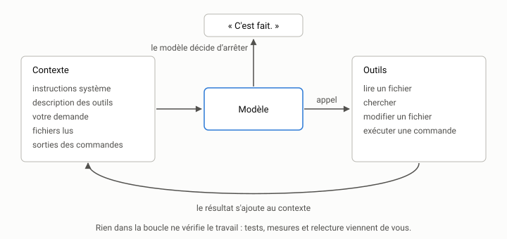

# Travailler avec un agent de codage {#sec-s01}

::: {.callout-note appearance="simple" .semaine}
## Cette semaine

Objectifs
: Comprendre ce que fait un agent de codage, ce qu'il voit et ce qu'il ne
  voit pas. Reconnaître ses trois modes d'échec typiques. Mener et consigner
  ses premières sessions sur le dépôt `indexeur`.

Lectures
: Anthropic, [*Building Effective Agents*](https://www.anthropic.com/research/building-effective-agents)
  (2024), les sections sur les agents. Becker et coll. (2025), [l'étude du
  METR](https://arxiv.org/abs/2507.09089) : le résumé, l'introduction et la
  section des résultats.

Activité
: Installer l'environnement ([mise en route](../../mise-en-route.qmd)), puis
  deux sessions commentées sur `indexeur`.

Durée estimée
: 8 heures, dont 2 heures d'installation.
:::

## Un modèle, une boucle, des outils

Un agent de codage est fait de trois choses :

1. un modèle de langue, qui reçoit un texte et produit la suite;
2. des outils, c'est-à-dire des fonctions que le modèle peut demander
   d'appeler : lire un fichier, chercher dans le dépôt, modifier un fichier,
   exécuter une commande;
3. une boucle, qui fait alterner le modèle et les outils jusqu'à ce que le
   modèle déclare avoir fini.

La boucle tient en quelques lignes :

```python
contexte = [instructions_systeme, description_des_outils, demande]
while True:
    reponse = modele(contexte)
    if reponse.appel_outil is None:
        break                                  # le modèle a « fini »
    resultat = executer(reponse.appel_outil)   # lire, éditer, lancer pytest…
    contexte += [reponse, resultat]
afficher(reponse.texte)
```

{fig-alt="Le contexte alimente le modèle; le modèle appelle un outil (lire, chercher, modifier, exécuter); le résultat s'ajoute au contexte. La boucle s'arrête quand le modèle décide d'arrêter."}

Tout le reste (l'interface, les permissions, les sous-agents, la mémoire)
est construit autour de cette boucle. Deux conséquences en découlent, et le
cours y reviendra sans cesse.

*L'agent ne sait que ce qui est dans son contexte.* Il connaît vos
instructions, votre demande, les fichiers qu'il a lus et la sortie des
commandes qu'il a lancées. Il ne connaît pas la réunion d'hier, la convention
que « tout le monde connaît » mais que personne n'a écrite, ni la raison
pour laquelle ce code bizarre est là. Ce que vous n'écrivez pas, l'agent le
devine, et il devine avec assurance.

*L'agent s'arrête quand le modèle décide de s'arrêter.* Rien, dans la
boucle, ne vérifie que la tâche est réussie. Si le modèle « pense » avoir
fini, la boucle s'arrête. Tout ce qui garantit la qualité du résultat, que
ce soit un test, une mesure ou une relecture, doit être ajouté par vous :
dans la demande, dans les outils ou dans votre façon de travailler.

## L'amplification

Avant les agents, écrire du code coûtait cher et le relire coûtait à peu
près autant. Une demande mal formulée produisait peu de code, lentement, et
l'erreur de cadrage se voyait vite.

Avec un agent, produire du code ne coûte presque plus rien, mais le
*vérifier* coûte toujours autant. Une demande floue produit maintenant deux
cents lignes plausibles en trois minutes. Elles compilent, elles passent
peut-être les tests, et elles sont peut-être fausses, ou justes mais au
mauvais endroit, ou justes mais avec une dépendance que le projet interdit.
L'agent n'a pas créé l'erreur : il l'a amplifiée.

C'est l'idée centrale du cours. Les agents ne remplacent pas la discipline
du génie logiciel. Ils en augmentent le rendement : une bonne habitude
(une tâche bornée, un test écrit d'abord, une mesure avant d'affirmer)
rapporte davantage, et une mauvaise coûte davantage.

## Ce que disent les mesures

Les agents rendent-ils plus productif? Deux études souvent citées se
contredisent en apparence.

- @peng2023copilot ont demandé à des développeurs d'écrire un serveur HTTP
  en JavaScript. Le groupe qui avait accès à GitHub Copilot a fini 55,8 %
  plus vite que le groupe témoin.
- @becker2025metr (METR) ont suivi seize développeurs expérimentés de
  logiciels libres, sur 246 tâches réelles de leurs propres dépôts, des
  projets matures qu'ils connaissaient bien. Avec les outils d'IA de début
  2025, ils ont été 19 % plus lents. Ils prévoyaient pourtant, avant
  l'étude, d'aller 24 % plus vite, et ils croyaient encore, après coup, être
  allés 20 % plus vite.

Ces deux résultats ne s'opposent pas vraiment. Ils mesurent des choses
différentes : une tâche neuve, isolée et bien définie dans un cas, et des
tâches dans de grands projets existants, aux exigences implicites, dans
l'autre. Les outils ont aussi beaucoup changé depuis. On peut toutefois
retenir deux leçons durables.

1. *L'effet dépend de la tâche et du contexte.* Il n'y a pas de facteur
   d'accélération universel.
2. *Notre impression ne vaut pas une mesure.* Les développeurs du METR se
   sont trompés de près de 40 points de pourcentage sur leur propre vitesse.
   C'est pour cela que vous tiendrez un [carnet de
   bord](../../mise-en-route.qmd#sec-carnet) : à la semaine 15, vous jugerez
   l'apport des agents sur vos données.

## Trois modes d'échec

Vous verrez ces trois échecs dès cette semaine. Apprenez à les nommer.

*1. Faire autre chose que ce qui est demandé.* On demande de corriger une
fonction, et l'agent « en profite » pour renommer des variables dans trois
autres fichiers, reformater le module et ajouter une option que personne n'a
demandée. Chaque changement est peut-être raisonnable, mais le diff devient
impossible à relire, et l'un d'eux casse quelque chose ailleurs. On parle de
*dérive de périmètre* (*scope creep*).

*2. Affirmer sans vérifier.* « J'ai corrigé le problème et tous les tests
passent. » L'agent a-t-il exécuté les tests? Tous les tests, ou un seul
fichier? Après la dernière modification, ou avant? Un modèle de langue
produit le texte le plus plausible, et « tous les tests passent » est une
conclusion très plausible. Lisez ce que l'agent a fait (les commandes,
leur sortie), pas ce qu'il dit avoir fait.

*3. Faire passer les tests au lieu de résoudre le problème.* Quand un test
échoue, l'agent dispose de deux façons de le faire passer : corriger le code,
ou modifier le test. Il peut aussi ajouter un cas particulier qui reconnaît
l'entrée du test. Les agents récents le font moins souvent qu'avant, mais ils
le font encore, surtout sous la pression d'une demande du type « fais passer
les tests ». Les semaines 5 à 7 portent sur la façon de s'en protéger.

## Une première session, commentée

Voici une session typique sur `indexeur`. La demande est petite et
raisonnable :

> Ajoute une commande `indexeur termes DOSSIER` qui affiche les dix termes
> les plus fréquents du corpus.

L'agent lit `cli.py`, puis `index.py`, puis `texte.py`. Il ajoute une
sous-commande, `commande_termes`, qui parcourt `index.frequences` et somme les
occurrences par terme. Il lance `uv run indexeur termes exemples`, obtient une
liste plausible et annonce : « C'est fait! »

Avant d'accepter, posez quatre questions. Elles reviendront toute la session.

1. *Qu'est-ce qui a changé?* `git diff --stat` : un seul fichier, `cli.py`,
   environ vingt lignes. Bien.
2. *Les tests passent-ils?* `uv run pytest` : oui, mais aucun test ne
   porte sur la nouvelle commande. L'agent ne l'a vérifiée qu'à l'œil, une
   fois.
3. *L'architecture est-elle respectée?* Le calcul de fréquence totale vit
   dans `cli.py`, alors qu'`ARCHITECTURE.md` dit que `cli.py` ne contient
   « aucune logique de recherche ». On peut en discuter. Une méthode
   `Index.termes_frequents(n)` serait plus cohérente et testable sans passer
   par la ligne de commande.
4. *La sortie est-elle déterministe?* Deux termes de même fréquence
   apparaissent-ils toujours dans le même ordre? Ici, non : l'ordre dépend de
   celui du dictionnaire. C'est contraire à la règle 3 d'`ARCHITECTURE.md`.

L'agent n'a rien fait d'absurde. Il a fait exactement ce qu'on lui a
demandé, et rien de ce qu'on ne lui a pas dit. Le problème est dans la
demande : elle ne mentionnait ni test, ni emplacement, ni règle de
départage. La semaine 3 montre comment l'écrire.

## Activité

L'activité se fait sur votre copie d'`indexeur`, dans une branche
`semaine-01`.

1. *Installation.* Faites la [mise en route](../../mise-en-route.qmd) :
   environnement, agent, dépôt, carnet.

2. *Session 1 : faire expliquer.* Dans une session neuve, demandez à
   l'agent : « Explique l'architecture de ce projet : les modules, leurs
   responsabilités et le sens des dépendances. Ne modifie aucun fichier. »
   Comparez sa réponse à `ARCHITECTURE.md`, sans lui avoir dit que ce
   fichier existe. A-t-il trouvé le fichier? A-t-il inventé quelque chose?
   Quels fichiers a-t-il lus, et combien de jetons cela a-t-il coûté?

3. *Session 2 : une petite tâche.* Dans une session neuve, donnez la
   demande de la section précédente, mot pour mot. Laissez l'agent finir
   sans intervenir. Puis appliquez les quatre questions : diff, tests,
   architecture, déterminisme. Notez dans le carnet tout ce que vous auriez
   dû préciser.

4. *Session 3 : recommencer.* Annulez (`git restore .` et `git clean -fd`,
   après avoir regardé ce qui sera effacé avec `git clean -n`). Réécrivez
   la demande pour qu'elle réponde d'avance aux quatre questions, puis
   relancez-la dans une session neuve. Comparez le temps, les jetons et le
   résultat.

5. *Carnet.* Trois entrées, une par session.

::: {.callout-tip}
## Une session neuve, chaque fois

Repartir d'une session neuve à chaque essai n'est pas un détail. Une
deuxième tentative dans la même session hérite du contexte de la première,
erreurs comprises. La semaine 13 y revient en détail.
:::

## À retenir

- Un agent, c'est un modèle, des outils et une boucle. La boucle s'arrête
  quand le modèle le décide, pas quand le travail est vérifié.
- L'agent ne sait que ce qui est dans son contexte. Ce que vous n'écrivez
  pas, il le devine.
- Les agents amplifient : les bonnes habitudes rapportent plus, et les
  mauvaises coûtent plus.
- Notre impression de productivité est peu fiable. On mesure.
- Trois échecs à reconnaître : la dérive de périmètre, l'affirmation non
  vérifiée et le test qu'on contourne.

## Questions

1. Dans la session 2, combien des problèmes relevés étaient de vraies
   erreurs de l'agent, et combien venaient d'informations absentes de la
   demande?
2. L'étude du METR porte sur des développeurs qui connaissaient très bien
   leur dépôt. Pourquoi cela pourrait-il réduire le gain apporté par un
   agent? Dans quelles situations vous attendriez-vous au contraire à un
   gain important?
3. Votre agent vous a-t-il demandé la permission avant d'exécuter une
   commande? Lesquelles? Lesquelles auriez-vous voulu qu'il demande?

## Autoévaluation

:::: {.qcm}
::: {.question}
Qu'est-ce qui met fin à la boucle d'un agent de codage?

- L'exécution réussie de la suite de tests
- Le modèle, quand il décide qu'il a fini []{.bonne}
- La relecture du diff par la personne qui a fait la demande
- L'épuisement de la fenêtre de contexte, et seulement elle

::: {.explication}
La boucle s'arrête quand le modèle ne demande plus d'outil. Rien n'y vérifie
que la tâche est réussie : les tests, les mesures et la relecture, c'est à
vous de les ajouter.
:::
:::

::: {.question}
Votre projet a une convention que toute l'équipe connaît, mais qui n'est
écrite nulle part. Que fera l'agent?

- Il la respectera, puisqu'elle est visible dans le code
- Il la devinera, avec plus ou moins de bonheur, et avec assurance []{.bonne}
- Il refusera de travailler tant qu'elle n'est pas écrite
- Il posera toujours la question avant de modifier le code

::: {.explication}
L'agent ne sait que ce qui est dans son contexte. Il peut parfois déduire une
convention du code, mais rien ne le garantit, et il ne signale pas qu'il
devine.
:::
:::

::: {.question}
Dans l'étude du METR [@becker2025metr], qu'est-il arrivé aux développeurs
expérimentés qui utilisaient des outils d'IA sur leurs propres dépôts?

- Ils ont été environ 20 % plus rapides, comme ils le prévoyaient
- Ils ont été 55,8 % plus rapides
- Ils ont été 19 % plus lents, tout en croyant avoir été plus rapides []{.bonne}
- Leur vitesse n'a pas changé

::: {.explication}
Ils ont été 19 % plus lents et croyaient, après coup, avoir gagné 20 %. Le
chiffre de 55,8 % vient d'une autre étude [@peng2023copilot], sur une tâche
neuve et isolée. D'où la règle du cours : on mesure, on ne se fie pas à son
impression.
:::
:::

::: {.question}
L'agent annonce : « J'ai corrigé le bogue et tous les tests passent. » Que
faites-vous d'abord?

- Vous acceptez : l'agent a accès au terminal
- Vous regardez les commandes qu'il a réellement exécutées et leur sortie, puis vous relancez les tests vous-même []{.bonne}
- Vous lui demandez de confirmer que tous les tests passent
- Vous relisez son message pour vérifier qu'il est cohérent

::: {.explication}
« Tous les tests passent » est une conclusion très plausible, donc facile à
produire, qu'elle soit vraie ou non. Jugez ce que l'agent a fait, pas ce
qu'il dit avoir fait.
:::
:::

::: {.question}
On demande de corriger une fonction. L'agent la corrige, mais renomme aussi
des variables dans trois autres fichiers et reformate un module. Comment
appelle-t-on ce mode d'échec?

- La dérive de périmètre []{.bonne}
- Le contournement des tests
- L'hallucination de paquet
- La compaction du contexte

::: {.explication}
C'est la dérive de périmètre (*scope creep*). Chaque changement est peut-être
raisonnable, mais le diff devient difficile à relire, et l'un des changements
peut casser autre chose.
:::
:::
::::
