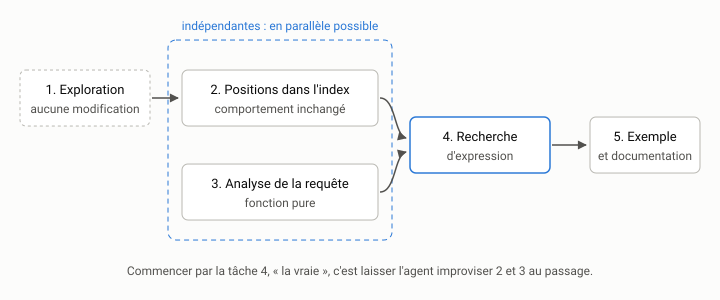

# Décomposer une demande {#sec-s02}

::: {.callout-note appearance="simple" .semaine}
## Cette semaine

Objectifs
: Transformer une demande d'utilisateur en une suite ordonnée de tâches,
  chacune assez petite pour donner un commit qu'on peut relire. Distinguer
  les tâches d'exploration des tâches de modification. Critiquer la
  décomposition proposée par un agent.

Lectures
: Anthropic, [*Building Effective Agents*](https://www.anthropic.com/research/building-effective-agents)
  (2024), la section sur l'enchaînement d'invites (*prompt chaining*) et
  celle sur l'orchestrateur et ses exécutants (*orchestrator-workers*).
  Beck (2002), la première partie : la façon dont l'auteur tient une liste
  de choses à faire et n'en traite qu'une à la fois.

Activité
: Décomposer la demande 1 du `README.md` d'`indexeur` (recherche d'une
  expression exacte), d'abord seul, puis avec un agent, et comparer.

Durée estimée
: 8 heures.
:::

## Une demande n'est pas une tâche

Relisez la première demande du `README.md` d'`indexeur` :

> « Ce serait bien de pouvoir chercher une expression exacte, entre
> guillemets, comme `"cabane à sucre"`. »

C'est une vraie demande, formulée comme le sont les vraies demandes : par
quelqu'un qui sait ce qu'il veut obtenir, mais pas ce qu'il faut changer pour
l'obtenir. Ce n'est pas une tâche. Une tâche, au sens de ce cours, est un
travail qu'on peut confier à un agent dans une session, et dont on peut
vérifier le résultat sans tout relire. Entre la demande et les tâches, il y a
un travail de décomposition. Il vous revient.

Pourquoi ne pas tout confier d'un coup? Essayez, c'est d'ailleurs le début de
l'activité. Un agent récent produira probablement quelque chose qui
fonctionne sur l'exemple de la demande. Il touchera trois ou quatre modules
et ajoutera une centaine de lignes. Il aura pris en route une dizaine de
décisions que personne ne lui a demandé de prendre, et que vous découvrirez
en relisant, si vous relisez. La semaine 1 a montré que l'agent devine ce que
vous n'écrivez pas. Plus la demande est grosse, plus il devine.

## Ce que la demande ne dit pas

Avant de découper, il faut comprendre. Lisez le code concerné, puis dressez
la liste des questions que la demande laisse ouvertes. Pour la recherche
d'expression, en lisant `texte.py`, `index.py` et `recherche.py`, on trouve
au moins celles-ci.

*L'index ne connaît pas les positions.* `Index.ajouter` garde, pour chaque
terme, la liste des documents qui le contiennent et le nombre d'occurrences
(`self.frequences`). Il ne garde pas *où* le terme apparaît. Or, pour savoir
que « cabane » est immédiatement suivi de « sucre », il faut les positions. Il
faudra donc modifier la structure centrale du programme, et ce n'est pas un
détail.

*Les mots vides disparaissent.* `texte.termes("cabane à sucre")` donne
`['cabane', 'sucre']` : « à » devient « a », qui est un mot vide. Faut-il
compter les positions avant ou après le retrait des mots vides? Après, et
`"cabane à sucre"` trouvera aussi « cabane de sucre ». Avant, il faut décider
ce que veut dire une expression qui contient un mot vide qu'on n'indexe pas.
Aucune réponse n'est évidente. C'est une décision de conception, et elle ne
doit pas être prise par accident au milieu d'un diff.

*Les guillemets n'existent pas encore.* Aujourd'hui, `texte.mots` découpe
avec l'expression régulière `\w+` : les guillemets sont simplement ignorés.
La requête `"cabane à sucre"` (avec les guillemets) donne déjà un résultat,
mais c'est le résultat d'une recherche ordinaire de tous les termes. Il faut
donc analyser la requête : repérer les passages entre guillemets, et
probablement accepter un mélange (`"cabane à sucre" érable`). Que faire d'un
guillemet non fermé? Des guillemets typographiques (« », “ ”)?

*Où mettre ce code?* `ARCHITECTURE.md` pose une règle : une seule
normalisation, dans `texte.termes`. Le découpage d'une requête en expressions
appartient-il à `texte.py` ou à `recherche.py`? Le score BM25 d'une
expression se calcule-t-il comme celui de ses termes?

*Que vérifier, et comment?* Il faut des tests pour les positions, pour
l'analyse de la requête et pour la recherche elle-même, plus un exemple dans
`exemples/` qui distingue « cabane à sucre » de « sucre de la cabane ».

Cette liste vaut plus que toute décomposition faite trop tôt. Certaines
questions se règlent en lisant le code. D'autres demandent une décision
(la vôtre, ou celle de la personne qui a fait la demande). Notez les
décisions : elles iront dans les fiches de tâche de la semaine 3.

## Granularité : une tâche, un commit relisible

Quelle taille doit avoir une tâche? Le critère le plus utile n'a rien à
voir avec les agents : une tâche doit donner un commit que vous pouvez
relire attentivement en quelques minutes. En pratique, cela veut dire une
idée par commit, un diff de quelques dizaines de lignes, rarement plus de
deux ou trois fichiers, et des tests qui passent à la fin.

Ce critère a plusieurs avantages.

- *La relecture reste possible.* Un diff de 40 lignes se lit. Un diff de 400
  lignes se survole, et on finit par l'accepter par fatigue.
- *L'échec coûte peu.* Si l'agent rate une petite tâche, on l'annule
  (`git restore .`) et on recommence avec une meilleure fiche. On a perdu dix
  minutes. Si l'agent rate une grosse tâche aux trois quarts, on hésite entre
  tout jeter et corriger à la main un code qu'on n'a pas écrit.
- *L'historique raconte quelque chose.* Chaque commit dit pourquoi il
  existe. Plus tard, `git bisect` pourra trouver lequel a introduit une
  régression.
- *Le contexte de l'agent reste petit.* Une session courte et ciblée lit
  peu de fichiers et coûte peu de jetons (semaine 13).

Une tâche peut aussi être trop petite. « Ajoute un attribut `positions` à
`Index` » ne se vérifie pas seule : on ne peut pas tester un attribut que rien
ne remplit. Le bon grain est le plus petit changement qui a un effet
observable par un test.

## Le critère de fin

Une tâche sans critère de fin n'est pas bornée. L'agent s'arrêtera quand le
modèle jugera avoir fini (semaine 1), ce qui peut être trop tôt ou beaucoup
trop tard. Formulez la fin comme quelque chose qu'on constate :

- « `uv run pytest` passe, et `tests/test_index.py` contient un test qui
  vérifie les positions de `"chat chien chat"`. »
- « La commande `uv run indexeur chercher exemples '"cabane à sucre"'` affiche
  `erabliere.txt` et lui seul. »
- « Aucun fichier hors de `src/indexeur/index.py` et `tests/test_index.py`
  n'est modifié. »

Évitez les critères qu'on ne peut que ressentir : « le code est propre »,
« c'est robuste », « gère bien les cas limites ». L'agent les déclarera
satisfaits, et vous ne pourrez pas le contredire sans relire tout le diff.

## Dépendances et ordre

Les tâches dépendent les unes des autres. Pour la recherche d'expression,
un ordre raisonnable est le suivant.

1. *Exploration.* Recenser ce qui, dans le code et les tests, dépend de la
   structure de l'index (`postings`, `frequences`). Aucune modification.
2. *Positions dans l'index.* `Index` garde la position de chaque occurrence.
   Les méthodes existantes ne changent pas de comportement, et les tests
   existants passent sans modification.
3. *Analyse de la requête.* Une fonction qui sépare une requête en
   expressions et en termes isolés. C'est une fonction pure, testable seule.
4. *Recherche d'expression.* `rechercher` filtre les candidats qui
   contiennent l'expression, en s'appuyant sur 2 et 3.
5. *Exemple et documentation.* Un fichier dans `exemples/`, un test de la
   ligne de commande, le `README.md` à jour.

{fig-alt="Graphe de dépendances : 1, exploration sans modification, mène à 2, positions dans l'index. 2 et 3, analyse de la requête, sont dans un cadre pointillé marqué « indépendantes : en parallèle possible ». 2 et 3 mènent à 4, recherche d'expression, qui mène à 5, exemple et documentation."}

Les tâches 2 et 3 ne dépendent pas l'une de l'autre. On pourrait les mener en
parallèle, dans deux arbres de travail distincts (semaine 14). La tâche 4
dépend des deux. Dessiner ce petit graphe avant de commencer évite une erreur
fréquente : demander la tâche 4 en premier parce que c'est « la vraie »
fonctionnalité, et laisser l'agent improviser 2 et 3 au passage.

Remarquez la tâche 2 et son critère : *les tests existants passent sans
modification*. C'est une tâche de préparation. Elle change la structure
sans changer le comportement, ce qui la rend facile à vérifier. La semaine 4
y revient sous son vrai nom : le refactoring préparatoire.

## Explorer avant de modifier

La tâche 1 de la liste ne produit aucun code. C'est une tâche
d'exploration : on demande à l'agent de lire, de chercher et de rapporter,
sans rien modifier. Ces tâches sont sous-estimées. Elles sont pourtant
celles où l'agent rapporte le plus pour le moins de risque.

- Elles sont sans danger : demandez explicitement de ne modifier aucun
  fichier, et vérifiez avec `git status` que c'est bien le cas.
- Elles sont rapides : un agent lit un dépôt de quelques milliers de
  lignes plus vite que vous.
- Elles produisent du texte que vous pouvez vérifier : une liste de
  fichiers et de fonctions, avec des numéros de ligne. Vérifiez quelques
  affirmations au hasard. Si l'une est fausse, méfiez-vous des autres.

Exemples de demandes d'exploration sur `indexeur` :

> Liste tous les endroits du code et des tests qui lisent ou modifient
> `Index.postings` ou `Index.frequences`, avec le fichier et le numéro de
> ligne. Ne modifie aucun fichier.

> Si on voulait garder la position de chaque terme dans chaque document, quels
> tests existants devraient changer? Réponds sans modifier de fichier.

Le résultat d'une exploration nourrit la décomposition. Il est aussi un bon
contexte à coller dans les fiches des tâches suivantes (semaine 3), à
condition de l'avoir vérifié.

Gardez séparées l'exploration et la modification. Une session qui commence
par « regarde comment ça marche, puis ajoute… » mélange les deux : l'agent
commence à modifier avant que vous ayez lu ce qu'il a compris.

## Faire décomposer par l'agent

Rien n'empêche de demander la décomposition à l'agent lui-même. C'est même
une bonne idée, à condition de traiter sa réponse comme une proposition,
et non comme un plan. C'est le motif « orchestrateur et exécutants » décrit
par @anthropic2024agents. Ici, l'orchestrateur, c'est vous : l'agent propose,
et vous décidez.

Une demande de décomposition utile ressemble à ceci :

> Voici une demande d'utilisateur : « Ce serait bien de pouvoir chercher une
> expression exacte, entre guillemets, comme `"cabane à sucre"`. » Lis
> `ARCHITECTURE.md` et le code de `src/indexeur/`. Ne modifie aucun fichier.
> Propose une décomposition en tâches de quelques dizaines de lignes chacune,
> dans l'ordre où il faudrait les faire. Pour chaque tâche, donne les fichiers
> touchés et un critère de fin vérifiable par une commande. Liste ensuite les
> questions de conception que la demande laisse ouvertes.

Critiquez la réponse avec une grille fixe :

1. *Les questions ouvertes.* L'agent a-t-il vu le problème des mots vides?
   celui des positions absentes? En a-t-il inventé qui n'existent pas? S'il a
   tranché une question sans la signaler, c'est le défaut le plus grave : une
   décision cachée dans un plan devient une décision cachée dans le code.
2. *La taille.* Chaque tâche donne-t-elle un commit relisible? Les
   décompositions d'agents ont tendance à proposer une première tâche énorme
   (« implémenter la recherche d'expression ») suivie de petites tâches
   cosmétiques (« mettre à jour la documentation »).
3. *Les critères de fin.* Sont-ils constatables? « Les tests passent »
   ne suffit pas si aucune tâche n'ajoute de test.
4. *L'architecture.* Les tâches respectent-elles le sens des dépendances
   d'`ARCHITECTURE.md`? Une tâche qui fait lire des fichiers à `recherche.py`
   viole la règle 2.
5. *Le superflu.* L'agent propose-t-il des choses que personne n'a
   demandées, comme une syntaxe de requête complète, des opérateurs
   booléens ou un cache? Rayez-les. La demande 6 (le OU) est une autre
   demande.

Une bonne pratique consiste à faire les deux : décomposer d'abord vous-même,
sur papier, en quinze minutes, puis demander la décomposition à l'agent et
comparer. Ce qu'il a vu et que vous aviez manqué vous apprend quelque chose
sur le code. Ce que vous aviez vu et qu'il a manqué vous apprend quelque
chose sur l'agent.

## Quand ne pas décomposer

La décomposition a un coût : du temps de réflexion, des fiches à écrire, des
sessions à lancer. Pour une correction d'une ligne, une faute de frappe dans
un message ou le renommage d'une variable locale, une demande directe suffit.
Le critère reste le même : si le résultat se relit en une minute, inutile de
découper. Vous apprendrez à juger au fil des semaines, et votre carnet vous y
aidera. Notez les tâches où vous avez découpé « pour rien », et celles que
vous regrettez de ne pas avoir découpées.

## Activité

Travaillez dans votre copie d'`indexeur`, sur une branche `semaine-02`
partie du commit de départ.

1. *Lire.* Relisez `texte.py`, `index.py` et `recherche.py` en ayant la
   demande 1 en tête. Dans un fichier `taches/expression-questions.md`, notez
   toutes les questions que la demande laisse ouvertes. Visez au moins cinq
   questions. Pour chacune, indiquez si elle se règle en lisant le code ou si
   elle demande une décision.

2. *Décomposer seul.* Dans `taches/expression-plan.md`, écrivez votre
   décomposition : une liste ordonnée de tâches, avec pour chacune les
   fichiers touchés, un critère de fin vérifiable et les dépendances. Marquez
   les tâches d'exploration.

3. *Explorer avec l'agent.* Dans une session neuve, lancez la première
   demande d'exploration de la section « Explorer avant de modifier ».
   Vérifiez trois de ses affirmations dans le code. Vérifiez avec `git status`
   qu'aucun fichier n'a changé.

4. *Faire décomposer.* Dans une autre session neuve, lancez la demande
   de décomposition de la section « Faire décomposer par l'agent ». Copiez sa
   réponse dans `taches/expression-plan-agent.md`, puis critiquez-la avec la
   grille en cinq points.

5. *Comparer et trancher.* Fusionnez les deux plans en un plan final.
   Tranchez au moins la question des mots vides, et justifiez votre choix en
   deux phrases. Ce plan servira à la semaine 3.

6. *Exécuter une tâche.* Faites exécuter par l'agent la première tâche de
   modification de votre plan (probablement les positions dans l'index),
   dans une session neuve. Relisez le diff. Les tests existants passent-ils
   sans avoir été modifiés?

7. *Carnet.* Une entrée par session. Pour la session 4, notez combien de
   questions ouvertes l'agent a trouvées par rapport à vous.

Faites un commit des fichiers de `taches/`. Ils font partie de votre
historique de travail.

## À retenir

- Une demande n'est pas une tâche. Entre les deux, il y a la lecture du code
  et la liste des questions ouvertes.
- Une tâche donne un commit qu'on relit en quelques minutes, et elle a un
  effet observable par un test.
- Un critère de fin se constate par une commande, pas par une impression.
- On ordonne les tâches selon leurs dépendances, et on fait d'abord les
  tâches de préparation, qui ne changent pas le comportement.
- Les tâches d'exploration ne modifient rien et coûtent peu. Elles sont
  sous-utilisées.
- L'agent peut proposer une décomposition, mais c'est vous qui décidez. Les
  décisions de conception cachées dans son plan sont le premier défaut à
  chercher.

## Questions

1. Dans votre plan final, quelle tâche a le diff le plus gros? Pourrait-on la
   couper en deux sans créer une tâche qu'on ne peut pas tester seule?
2. L'agent a-t-il tranché une question de conception sans le dire? Comment
   l'avez-vous remarqué?
3. Prenez la demande 7 (« Pouvoir retirer un document de l'index »). Sans
   écrire de plan complet, quelle serait la première tâche d'exploration?
   Quelle question ouverte vous paraît la plus difficile?
4. La tâche « positions dans l'index » a pour critère « les tests existants
   passent sans modification ». Est-ce suffisant pour savoir que les
   positions sont justes? Que faudrait-il ajouter?

## Autoévaluation

:::: {.qcm}
::: {.question}
Selon le critère du cours, quelle est la bonne taille pour une tâche confiée à un agent?

- La plus grosse tâche que l'agent peut réussir en une session
- Un fichier par tâche, quel que soit le changement
- Un changement qui donne un commit qu'on peut relire attentivement en quelques minutes, avec un effet observable par un test []{.bonne}
- Une ligne de code par tâche, pour minimiser le risque

::: {.explication}
Le critère est la relecture : une idée par commit, un diff de quelques dizaines de lignes. Une tâche trop petite (un attribut que rien ne remplit) ne se vérifie pas seule.
:::
:::

::: {.question}
Lequel de ces énoncés est un bon critère de fin?

- La commande uv run indexeur chercher exemples '"cabane à sucre"' affiche erabliere.txt et lui seul []{.bonne}
- Le code est propre et gère bien les cas limites
- La fonctionnalité est robuste
- L'agent confirme que la tâche est terminée

::: {.explication}
Un critère de fin se constate par une commande ou une observation. « Propre » et « robuste » ne se vérifient pas : l'agent les déclarera satisfaits, et vous ne pourrez le contredire qu'en relisant tout.
:::
:::

::: {.question}
Pourquoi demander d'abord une tâche d'exploration, sans modification de fichier?

- Parce que les agents ne savent pas modifier du code sans l'avoir exploré dans une session précédente
- Parce qu'elle est sans danger et rapide, et qu'elle produit des affirmations qu'on peut vérifier avant de décider du découpage []{.bonne}
- Parce qu'elle remplace la lecture du code par la personne qui demande
- Parce qu'elle consomme moins de jetons qu'une modification

::: {.explication}
L'exploration rapporte beaucoup pour peu de risque. Son résultat se vérifie par échantillonnage : si une affirmation est fausse, on se méfie des autres.
:::
:::

::: {.question}
Dans le plan de la recherche d'expression, pourquoi ne pas commencer par la tâche 4, la recherche elle-même?

- Parce qu'elle est la moins importante
- Parce qu'elle doit être faite à la main
- Parce qu'elle doit se faire en parallèle avec la tâche 5
- Parce qu'elle dépend des tâches 2 et 3, que l'agent improviserait alors au passage []{.bonne}

::: {.explication}
La tâche 4 a besoin des positions (2) et de l'analyse de la requête (3). La demander d'abord, c'est laisser l'agent prendre en route des décisions que personne n'a examinées.
:::
:::

::: {.question}
Vous demandez à l'agent de décomposer la demande. Quel défaut de sa proposition est le plus grave?

- Une tâche de documentation un peu trop courte
- Une question de conception tranchée sans être signalée []{.bonne}
- Un ordre des tâches différent du vôtre, mais cohérent
- Des noms de tâches en anglais

::: {.explication}
Une décision cachée dans un plan devient une décision cachée dans le code. Les autres défauts se voient et se corrigent facilement.
:::
:::
::::
