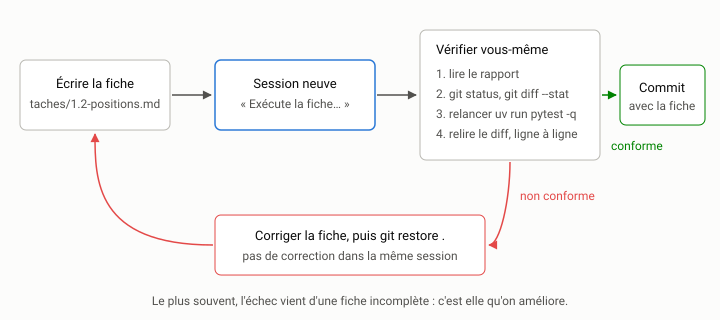

# Cadrer une tâche {#sec-s03}

::: {.callout-note appearance="simple" .semaine}
## Cette semaine

Objectifs
: Écrire une fiche de tâche bornée et vérifiable selon un gabarit fixe.
  Reconnaître les trois pièges du cadrage : la solution sur-spécifiée, la
  fiche trop longue et la fiche contradictoire. Mesurer l'effet d'un cadrage
  précis par rapport à un cadrage flou.

Lectures
: Anthropic, [*Building Effective Agents*](https://www.anthropic.com/research/building-effective-agents)
  (2024), l'annexe sur la conception des outils (*prompt engineering your
  tools*) : les conseils donnés pour décrire un outil à un modèle valent
  aussi pour décrire une tâche. La documentation de votre agent sur les
  bonnes pratiques de rédaction des demandes (par exemple, pour Claude Code,
  la page [*Best practices*](https://www.anthropic.com/engineering/claude-code-best-practices)).

Activité
: Écrire les fiches de la recherche d'expression (demande 1 du `README.md`),
  puis comparer, sur une même tâche, une demande floue et une fiche précise.

Durée estimée
: 9 heures.
:::

## Pourquoi une fiche

La semaine 2 a produit un plan : une liste ordonnée de tâches, avec des
critères de fin. Il reste à transmettre chaque tâche à l'agent. On pourrait
la taper dans la session, au fil de la pensée. On gagne pourtant à l'écrire
dans un fichier du dépôt, `taches/1.2-positions.md` par exemple, puis à dire
à l'agent : « Exécute la fiche `taches/1.2-positions.md`. »

Le fichier a plusieurs avantages sur la demande tapée.

- *On l'écrit à tête reposée*, en relisant le code, et non dans l'urgence
  d'une session ouverte.
- *On peut le rejouer.* Si l'agent échoue, on annule, on corrige la fiche
  et on relance une session neuve avec la même fiche. On sait alors que
  c'est la fiche qui a changé, et rien d'autre.
- *Il est versionné.* Le commit qui contient le code peut contenir aussi la
  fiche qui l'a demandé. Six mois plus tard, on sait pourquoi le code est
  ainsi.
- *On peut le comparer.* Le TP1 vous demande justement de comparer un
  cadrage flou et un cadrage précis. Sans fiches, il n'y a rien à comparer.

## Le gabarit

Une fiche a huit rubriques, toujours dans le même ordre. L'ordre compte peu
pour l'agent. Il compte pour vous : une rubrique vide se voit.

| Rubrique | Question | Exemple de défaut qu'elle évite |
|---|---|---|
| But | Quel effet observable veut-on, et pourquoi? | l'agent optimise autre chose que ce qu'on voulait |
| Contexte | Que faut-il lire avant de commencer? | l'agent devine une convention écrite ailleurs |
| Périmètre | Quels fichiers a-t-il le droit de modifier? | la dérive de périmètre (semaine 1) |
| Hors périmètre | Qu'est-ce qu'on ne fait *pas* dans cette tâche? | la tâche suivante faite à moitié, en passant |
| Contraintes | Quelles règles du projet s'appliquent? | une dépendance interdite, une sortie non déterministe |
| Critère d'acceptation | À quoi reconnaît-on que c'est fini et juste? | « c'est fait » sans preuve |
| Vérification | Quelles commandes exactes lancer? | des tests exécutés à moitié, ou pas du tout |
| Rapport | Que doit dire l'agent à la fin? | une décision prise en silence |

Voici le gabarit lui-même, à copier dans `taches/GABARIT.md` :

```markdown
# Tâche N.M — Titre court, à l'infinitif

## But
Une ou deux phrases : l'effet observable, et pourquoi on le veut.

## Contexte
- Fichiers à lire avant de commencer.
- Décisions déjà prises (avec leur raison, en une ligne).

## Périmètre
Fichiers que tu peux modifier ou créer :
- ...

## Hors périmètre
- Ce qu'on ne fait pas dans cette tâche (et qui viendra peut-être plus tard).

## Contraintes
- Règles d'ARCHITECTURE.md qui s'appliquent, par numéro.
- Autres contraintes (API, performance, compatibilité).

## Critère d'acceptation
- Énoncés vérifiables, un par ligne.

## Vérification
Lance, dans cet ordre, et montre la sortie :
    uv run pytest
    ...

## Rapport
À la fin, donne :
1. la liste des fichiers modifiés;
2. les commandes lancées et leur résultat;
3. toute décision que la fiche ne prévoyait pas;
4. les questions qui restent.
Ne fais pas de commit.
```

Deux remarques sur ce gabarit. La rubrique Rapport sert à combattre le
deuxième mode d'échec de la semaine 1 (affirmer sans vérifier) : on exige les
commandes et leur sortie, et pas seulement une conclusion. La consigne « Ne
fais pas de commit » vous laisse le dernier mot : c'est vous qui faites le
commit, après avoir relu le diff.

## Flou contre précis : un exemple complet

Reprenons la tâche « positions dans l'index » de la semaine 2. Voici la
demande floue, telle qu'on l'écrirait spontanément :

> Ajoute les positions des mots dans l'index pour qu'on puisse faire la
> recherche d'expressions.

Cette phrase laisse ouverts tous les points suivants. Positions de quoi : des
mots, ou des termes après normalisation? Comptées avant ou après le retrait des
mots vides? À partir de 0 ou de 1? Exposées comment au reste du programme?
Et « pour qu'on puisse faire la recherche d'expressions » est une invitation
à faire aussi la tâche suivante.

Voici la fiche précise. On suppose qu'à la semaine 2, on a décidé de compter
les positions après le retrait des mots vides. C'est un choix parmi
d'autres, et l'essentiel est qu'il soit écrit.

```markdown
# Tâche 1.2 — Garder les positions des termes dans l'index

## But
Pour chaque terme et chaque document, l'index doit connaître les positions
où le terme apparaît. La recherche d'expressions exactes (tâche 1.4) en
aura besoin. Cette tâche ne change aucun comportement existant.

## Contexte
- Lis ARCHITECTURE.md, src/indexeur/texte.py, src/indexeur/index.py
  et tests/test_index.py.
- Décision prise : une position est l'indice du terme dans la liste
  renvoyée par texte.termes(texte), à partir de 0. Les mots vides ne
  comptent donc pas. Exemple : termes("le chat et le chien") donne
  ["chat", "chien"]; « chat » est en position 0, « chien » en position 1.

## Périmètre
- src/indexeur/index.py
- tests/test_index.py

## Hors périmètre
- La recherche d'expressions elle-même (tâche 1.4) : ne touche pas à
  recherche.py.
- L'analyse des guillemets dans la requête (tâche 1.3).
- Toute optimisation de Index.ajouter (sujet du bloc 3).

## Contraintes
- Règles 1, 2 et 4 d'ARCHITECTURE.md : la normalisation reste dans
  texte.termes, aucune entrée-sortie, aucune dépendance.
- Les méthodes existantes (documents_avec, frequence, longueur_moyenne,
  __len__, __contains__) gardent exactement leur comportement.
- Les tests existants passent sans être modifiés.

## Critère d'acceptation
- Une nouvelle méthode Index.positions(terme, identifiant) renvoie la liste
  croissante des positions du terme dans le document, ou [] si le terme
  ou le document est absent.
- Après index.ajouter("a", "chat chien chat"),
  index.positions("chat", "a") vaut [0, 2] et
  index.positions("chien", "a") vaut [1].
- Pour tout terme et tout document, index.frequence(t, d) est égal à
  len(index.positions(t, d)).
- tests/test_index.py contient au moins trois nouveaux tests : l'exemple
  ci-dessus, un document avec des mots vides, un terme absent.

## Vérification
Lance, dans cet ordre, et montre la sortie :
    git diff --stat
    uv run pytest -q

## Rapport
À la fin, donne :
1. la liste des fichiers modifiés;
2. les commandes lancées et leur résultat;
3. toute décision que la fiche ne prévoyait pas;
4. les questions qui restent.
Ne fais pas de commit.
```

La fiche fait une quarantaine de lignes. C'est long pour une tâche qui
produira peut-être trente lignes de code. Mais la plupart des lignes de la
fiche ferment une porte que l'agent aurait pu ouvrir. Comparez ce que vous
obtenez dans les deux cas (c'est l'activité de la semaine) : les écarts sont
rarement dans le code central, et presque toujours dans tout ce qui l'entoure.

Remarquez aussi ce que la fiche ne dit pas : elle ne dit pas comment
stocker les positions. Un dictionnaire `(terme, identifiant) → liste`, une
liste par entrée de `postings`, une autre structure : c'est à l'agent de
choisir, et on jugera le choix au moment de relire. La fiche fixe le quoi
(l'interface, les exemples, l'invariant avec `frequence`) et laisse le
*comment*.

## Écrire un bon critère d'acceptation

Le critère d'acceptation est la rubrique la plus importante, et celle qu'on
bâcle le plus souvent. Quelques règles :

- *Donnez un exemple exact.* « `positions("chat", "a")` vaut `[0, 2]` »
  vaut mieux que trois phrases de description. Un exemple d'entrée et de
  sortie lève les ambiguïtés que la prose laisse passer (départ à 0 ou à 1,
  liste ou tuple, ordre).
- *Énoncez un invariant si vous en voyez un.* « `frequence` égale la
  longueur de `positions` » relie la nouvelle structure à l'ancienne. Un
  agent qui tient deux structures en parallèle risque de les désynchroniser.
  L'invariant le force à les garder cohérentes, et il donnera un excellent
  test de propriété à la semaine 6.
- *Dites quels tests doivent exister.* Sinon, l'agent écrira peut-être un
  seul test, ou aucun, et « les tests passent » ne voudra rien dire.
- *Dites ce qui ne doit pas changer.* « Les tests existants passent sans
  être modifiés » est le critère le plus simple qui protège contre le
  troisième mode d'échec de la semaine 1 (faire passer les tests en les
  modifiant). La semaine 7 montrera comment le faire respecter par
  l'outillage plutôt que par la confiance.

## Trois pièges

### Sur-spécifier la solution

La tentation est grande d'écrire la solution dans la fiche : « Ajoute un
attribut `self.positions = {}` de type `dict[tuple[str, str], list[int]]`,
et dans la boucle de `ajouter`, utilise `enumerate`… » À ce niveau de détail,
il serait plus rapide d'écrire le code vous-même. Surtout, vous privez
l'agent de ce qu'il fait bien (lire le code existant et trouver
l'implémentation qui s'y intègre) et vous gardez pour vous ce qu'il fait mal
(deviner l'intention).

La règle : spécifiez l'interface et le comportement, pas
l'implémentation, sauf quand l'implémentation est la contrainte.
« Sans dépendance externe », « sans changer la complexité de `ajouter` » et
« sans lire de fichier » sont des contraintes légitimes. « Utilise
`enumerate` » n'en est pas une.

### La fiche trop longue

Une fiche de trois pages est le symptôme d'une tâche trop grosse : revenez à
la décomposition de la semaine 2. Elle est aussi dangereuse en elle-même.
Plus une fiche est longue, plus il est probable qu'une consigne se perde au
milieu ou qu'elle en contredise une autre. Un modèle de langue utilise
d'ailleurs moins bien l'information placée au milieu d'un long contexte
qu'au début ou à la fin [@liu2024lost]. La semaine 13 y reviendra.

Ordre de grandeur : si la fiche dépasse une page d'écran (environ
soixante lignes), coupez la tâche. Évitez aussi d'y recopier le contenu
d'autres fichiers. Écrivez « Lis `ARCHITECTURE.md` » plutôt que d'en coller
le texte : l'agent lira la version à jour.

### La fiche contradictoire

Une fiche peut demander deux choses incompatibles sans que ce soit visible.
Voici un exemple réel sur `indexeur`. La tâche 1.5 de la semaine 2 (exemple
et documentation) pourrait contenir ces deux lignes :

```markdown
## Périmètre
- exemples/ (ajouter un fichier qui contient « sucre de la cabane »)
- README.md

## Contraintes
- Les tests existants passent sans être modifiés.
```

Or `tests/test_cli.py` contient :

```python
def test_stats(capsys):
    assert main(["stats", str(EXEMPLES)]) == 0
    sortie = capsys.readouterr().out
    assert "documents : 6" in sortie
```

Ajouter un septième fichier dans `exemples/` fait échouer ce test, que la
fiche interdit de modifier. Face à une contradiction, l'agent doit choisir.
Il peut modifier le test malgré la consigne, renoncer à l'exemple, ou bien,
dans le pire des cas, trouver un contournement qui satisfait la lettre des
deux consignes (placer le fichier ailleurs et changer le chemin dans un autre
test, par exemple). Le bon comportement est de s'arrêter et de signaler la
contradiction : c'est à cela que sert le point 4 de la rubrique Rapport
(« les questions qui restent »). Vous pouvez le rendre explicite : « Si deux
consignes de cette fiche te semblent incompatibles, arrête-toi et
signale-le. »

Le remède est en amont. Avant de lancer une fiche, relisez-la en vous
demandant : « Est-ce que je pourrais faire cette tâche moi-même en respectant
chaque ligne? » Ici, la réponse demande de modifier `test_stats`, ou de mettre
le nouvel exemple dans un dossier à part. Écrivez dans la fiche ce que vous
avez choisi.

## La fiche, l'agent et vous

Lancez chaque fiche dans une session neuve, en une phrase : « Exécute la
fiche `taches/1.2-positions.md`. » Puis, quand l'agent a terminé :

1. Lisez son rapport. Signale-t-il une décision imprévue? une question?
2. Vérifiez le périmètre : `git status` et `git diff --stat`. Un fichier
   hors périmètre a-t-il été touché?
3. Relancez vous-même la vérification (`uv run pytest -q`). Ne vous fiez pas
   à la sortie que l'agent affirme avoir obtenue.
4. Relisez le diff, critère d'acceptation à la main, ligne par ligne.
5. Si tout va bien, faites le commit avec la fiche, dans le même commit
   ou dans le précédent.

{fig-alt="Écrire la fiche, puis la faire exécuter dans une session neuve, puis vérifier soi-même en quatre étapes : lire le rapport, git status et git diff --stat, relancer uv run pytest -q, relire le diff. Si c'est conforme, commit avec la fiche. Sinon, corriger la fiche puis git restore, et recommencer, sans correction dans la même session."}

Si quelque chose ne va pas, ne corrigez pas dans la même session. Demandez-vous
d'abord si c'est la fiche qui était incomplète. Le plus souvent, c'est le cas.
Corrigez la fiche, annulez les modifications et relancez dans une session
neuve. C'est plus lent la première fois, mais vos fiches s'améliorent, et le
TP1 vous demandera justement de montrer cette amélioration.

## Activité

Travaillez sur votre branche `semaine-02`, ou sur une nouvelle branche
`semaine-03` partie de celle-ci.

1. *Gabarit.* Copiez le gabarit dans `taches/GABARIT.md` et faites-en un
   commit.

2. *Comparaison flou contre précis.* Partez d'un commit où les positions
   n'existent pas encore (le commit de départ, sur une branche
   `s03-flou`). Dans une session neuve, donnez la demande floue (« Ajoute les
   positions des mots dans l'index pour qu'on puisse faire la recherche
   d'expressions. »). Ne l'aidez pas, et laissez-la aller au bout. Puis, sur
   une branche `s03-precis` partie du même commit, faites exécuter la fiche
   précise de cette page (à adapter si votre décision sur les mots vides est
   différente). Comparez les deux branches avec `git diff s03-flou s03-precis
   --stat`, puis fichier par fichier. Pour chaque branche, notez :
   - les fichiers modifiés hors du périmètre de la fiche;
   - le nombre de tests ajoutés, et ce qu'ils vérifient vraiment;
   - si la branche floue a commencé la recherche d'expressions elle-même;
   - le temps et les jetons consommés.

3. *Les fiches de la recherche d'expression.* Écrivez les fiches des
   tâches de modification de votre plan de la semaine 2 (1.3, 1.4 et 1.5, ou
   leurs équivalents). Pour chacune, appliquez le test « pourrais-je la faire
   moi-même en respectant chaque ligne? ». Cherchez en particulier la
   contradiction de `test_stats` dans votre fiche 1.5.

4. *Exécution.* Faites exécuter la fiche 1.3 (analyse de la requête) dans
   une session neuve. Suivez les cinq étapes de la section précédente. Si
   vous devez corriger la fiche, gardez les deux versions (le commit de la
   première, puis celui de la seconde) : c'est exactement ce que le TP1
   demandera.

5. *Carnet.* Une entrée par session, en indiquant chaque fois la fiche
   utilisée et sa version.

## À retenir

- Une tâche se transmet par une fiche versionnée dans le dépôt, et non par
  une phrase tapée dans la session.
- Le gabarit a huit rubriques : but, contexte, périmètre, hors périmètre,
  contraintes, critère d'acceptation, vérification, rapport.
- Le critère d'acceptation contient un exemple exact, un invariant si
  possible, les tests qui doivent exister et ce qui ne doit pas changer.
- On spécifie le quoi, pas le comment, sauf quand le comment est la
  contrainte.
- Une fiche de plus d'une page signale une tâche trop grosse.
- Avant de lancer une fiche, on vérifie qu'on pourrait la respecter soi-même.
  Les contradictions se découvrent sinon dans le diff.
- Quand l'agent échoue, on corrige d'abord la fiche, puis on relance dans une
  session neuve.

## Questions

1. Dans votre comparaison, quelle rubrique de la fiche précise a eu le plus
   d'effet? Laquelle aurait pu être retirée sans rien changer au résultat?
2. L'agent a-t-il respecté la consigne « Ne fais pas de commit »? A-t-il
   signalé des décisions imprévues? Si oui, étaient-elles bonnes?
3. La fiche précise de cette page impose le nom `Index.positions`. Est-ce une
   sur-spécification? Défendez les deux points de vue.
4. Écrivez la rubrique Critère d'acceptation de la tâche 1.4 (recherche
   d'expression). Quel exemple exact choisiriez-vous dans `exemples/` pour
   qu'il distingue vraiment une recherche d'expression d'une recherche
   ordinaire de tous les termes?

## Autoévaluation

:::: {.qcm}
::: {.question}
Quel avantage une fiche versionnée a-t-elle sur une demande tapée dans la session?

- L'agent lit les fichiers plus attentivement que les messages
- Elle dispense de relire le diff
- On peut la rejouer après correction : si le résultat change, on sait que c'est la fiche qui a changé []{.bonne}
- Elle consomme moins de jetons

::: {.explication}
Une fiche se corrige, se relance dans une session neuve et se compare. Elle est aussi versionnée avec le code qu'elle a demandé.
:::
:::

::: {.question}
Pourquoi la rubrique Rapport exige-t-elle les commandes exécutées et leur sortie?

- Pour lutter contre l'affirmation non vérifiée : on veut une observation, pas une conclusion []{.bonne}
- Pour que l'agent puisse faire le commit lui-même
- Pour remplir le carnet de bord automatiquement
- Parce que pytest ne fonctionne pas sans cette consigne

::: {.explication}
« Tous les tests passent » est une conclusion plausible. La sortie de la commande est une observation. Vous relancez d'ailleurs la vérification vous-même.
:::
:::

::: {.question}
Laquelle de ces consignes sur-spécifie la solution?

- « Sans dépendance externe »
- « Sans changer la complexité de ajouter »
- « positions("chat", "a") vaut [0, 2] »
- « Ajoute un attribut self.positions de type dict[tuple[str, str], list[int]] et utilise enumerate » []{.bonne}

::: {.explication}
On spécifie l'interface et le comportement (l'exemple exact en est un), et les contraintes légitimes. Dicter l'implémentation prive l'agent de ce qu'il fait bien : trouver le code qui s'intègre à l'existant.
:::
:::

::: {.question}
Une fiche demande d'ajouter un fichier à exemples/ et interdit de modifier les tests existants. Or test_stats attend « documents : 6 ». Quel est le bon comportement de l'agent?

- Modifier test_stats, puisque l'ajout du fichier est l'objectif principal
- S'arrêter et signaler la contradiction []{.bonne}
- Mettre le fichier dans un autre dossier et changer le chemin dans un autre test
- Renoncer silencieusement à l'exemple

::: {.explication}
Face à une contradiction, l'agent doit la signaler (point 4 du Rapport). Le remède est en amont : relire la fiche en se demandant si on pourrait soi-même respecter chaque ligne.
:::
:::

::: {.question}
L'agent a mal fait la tâche. Que recommande la page?

- Lui expliquer l'erreur dans la même session, pour qu'il corrige
- Corriger le code à la main, puis faire le commit
- Se demander si la fiche était incomplète, la corriger, annuler les modifications et relancer dans une session neuve []{.bonne}
- Changer d'agent

::: {.explication}
Le plus souvent, c'est la fiche qui était incomplète. Corriger dans la même session hérite du contexte de l'échec; une session neuve teste la fiche corrigée, et seulement elle.
:::
:::
::::
