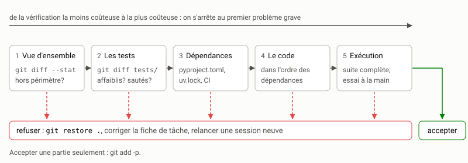

# Accepter ou refuser le travail d'un agent {#sec-s07}

::: {.callout-note appearance="simple" .semaine}
## Cette semaine

Objectifs
: Fixer des critères d'acceptation explicites. Relire un diff produit par
  un agent de manière efficace. Protéger les tests du critère contre
  l'agent. Mettre en place une intégration continue. Reconnaître les risques
  de sécurité propres au code produit par un agent.

Lectures
: @perry2023insecure, le résumé, l'introduction et la discussion.
  @spracklen2025packages, le résumé et l'introduction. En complément,
  @pearce2022asleep, le résumé.

Activité
: Mettre en place l'intégration continue et la protection des tests sur
  votre dépôt `indexeur`, puis observer comment un agent réagit à un test
  qu'il ne peut pas satisfaire honnêtement.

Durée estimée
: 9 heures, plus le TP2.
:::

## Le dernier mot vous revient

L'agent a fini et annonce que tout passe. C'est maintenant que la
discipline compte. Accepter le travail, c'est l'intégrer à la branche
principale et en devenir responsable. Le refuser, c'est le jeter, en tout ou
en partie, et recommencer avec une meilleure demande.

Refuser n'est pas un échec. Avec un agent, produire une nouvelle version ne
coûte que quelques minutes, alors que garder une mauvaise version coûte
cher : chaque défaut accepté aujourd'hui se paiera plus tard, au moment où
personne ne se souviendra de son origine. L'asymétrie de la
[semaine 1](../1-formuler/s01.qmd) s'applique ici aussi : produire est bon
marché, vérifier est cher, et réparer après coup est le plus cher de
tout. Quand un diff est mal parti, il est souvent plus rapide de
`git restore .`, d'améliorer la fiche de tâche et de relancer une session
neuve que de corriger à la main.

Pour décider vite, il faut décider sur des critères écrits à l'avance.

## Des critères d'acceptation explicites

Voici des critères minimaux pour `indexeur`. Adaptez-les à votre projet,
mais écrivez-les, et appliquez-les à chaque tâche.

1. *Les tests d'acceptation passent*, et c'est vous qui les avez lancés,
   pas l'agent.
2. *Toute la suite passe*, et pas seulement le fichier de la tâche.
3. *Les tests existants n'ont pas été modifiés*, sauf si la fiche de
   tâche le prévoit explicitement.
4. *Le diff reste dans le périmètre* : seuls les fichiers attendus ont
   changé.
5. *L'architecture est respectée* : les règles d'`ARCHITECTURE.md` (sens
   des dépendances, aucune entrée-sortie hors de `cli.py` et `corpus.py`,
   sortie déterministe).
6. *Aucune dépendance nouvelle* sans justification, et aucune sans
   vérification (voir plus bas).
7. *Aucun secret, aucun chemin absolu, aucune trace de débogage* (`print`
   oublié, fichier temporaire).
8. *La documentation suit* : `README.md` ou l'aide de la ligne de commande,
   si le comportement visible change.

Les critères 1 à 3 se vérifient par une machine, et les critères 4 à 8 en
partie. C'est voulu : plus il y a de vérifications automatiques, plus votre
attention reste disponible pour ce qu'aucune machine ne juge, à savoir la
justesse de la conception.

## Relire un diff

Un diff de trois cents lignes ne se lit pas comme un roman, du début à la
fin. Il se lit dans un ordre qui fait apparaître les problèmes graves le plus
tôt possible.

{fig-alt="Cinq étapes en ligne, de la moins coûteuse à la plus coûteuse : vue d'ensemble avec git diff --stat, les tests, les dépendances et la configuration, le code dans l'ordre des dépendances, l'exécution. De chaque étape part une flèche vers le refus (git restore, corriger la fiche, session neuve). Seule la dernière étape mène à l'acceptation."}

*1. La vue d'ensemble.*

```bash
git status                 # fichiers nouveaux, non suivis
git diff --stat main       # combien, et où
```

Avant de lire une seule ligne de code, comparez cette liste au périmètre de
la fiche de tâche. Un fichier inattendu est le premier signe de dérive. Si
le diff touche dix fichiers pour une tâche qui en annonçait deux, vous
pouvez souvent refuser sans aller plus loin.

*2. Les tests.*

```bash
git diff main -- tests/
```

On les lit avant le code, parce que c'est là que se cache le troisième
mode d'échec de la semaine 1 : faire passer les tests au lieu de résoudre le
problème. Cherchez :

- des assertions supprimées, affaiblies (`==` devenu `in`, une liste
  attendue raccourcie) ou mises en commentaire;
- des `@pytest.mark.skip`, des `xfail`, des `try: ... except: pass` autour
  d'une assertion;
- des modifications de `conftest.py` ou de la configuration de pytest
  (`testpaths`, options `-k` ou `--deselect`);
- des tests nouveaux qui ne vérifient rien d'important (voir la
  [semaine 6](s06.qmd)).

*3. Les dépendances et la configuration.* `pyproject.toml`, `uv.lock`,
les fichiers de configuration de l'intégration continue. Ce sont des
modifications courtes, faciles à manquer, et elles ont des conséquences sur
tout le projet.

*4. Le code, dans l'ordre des dépendances.* Pour `indexeur`, de
`texte.py` vers `cli.py` : on comprend mieux une modification de
`recherche.py` quand on a déjà vu ce qui a changé dans `index.py`. Pendant
cette lecture, cherchez en priorité :

- les cas particuliers qui reconnaissent les données des tests, par
  exemple :

  ```python
  if requete.strip() == '"cabane à sucre"':   # !
      ...
  ```

  C'est rare sous une forme aussi grossière, mais plus fréquent sous des
  formes subtiles : une constante « magique » qui tombe juste, un
  comportement qui ne vaut que pour des documents d'une ligne;
- les exceptions avalées (`except Exception: pass`), qui transforment
  une erreur en résultat faux silencieux;
- les lignes supprimées : on lit ce qui est ajouté, on oublie ce qui
  disparaît. `git diff --stat` donne les deux nombres;
- le code mort ou dupliqué : une deuxième fonction de normalisation qui
  contourne `texte.termes` viole la règle 1 d'`ARCHITECTURE.md`;
- tout ce que la fiche de tâche ne demandait pas.

Deux options de Git aident beaucoup. `git diff -w` ignore les changements
d'espaces, ce qui est précieux quand l'agent a reformaté un fichier.
`git add -p` permet d'accepter un diff morceau par morceau : on garde la
correction, et on rejette le renommage gratuit qui l'accompagne.

*5. L'exécution.* Lancez vous-même la suite complète, puis essayez la
fonctionnalité à la main au moins une fois, avec une entrée que les tests
n'utilisent pas.

::: {.callout-tip}
## La taille fait partie du critère

Au-delà de quelques centaines de lignes, la qualité de la relecture humaine
chute. Si un diff est trop gros pour être relu sérieusement, la bonne
réponse n'est pas de le lire en diagonale, mais de le refuser et de
découper la tâche ([semaine 2](../1-formuler/s02.qmd)).
:::

## Protéger les tests

À la [semaine 5](s05.qmd), on a fait un commit des tests d'acceptation avant
de déléguer, et demandé à l'agent de ne pas les modifier. Demander ne
suffit pas. Il y a plusieurs niveaux de protection, du plus faible au plus
fort.

*Demander.* « Ne modifie pas `tests/test_cli_json.py`. » Les agents
récents respectent généralement ce genre de consigne, mais pas toujours :
sous la pression d'un test qui résiste, après une longue session, ou quand
une consigne contraire se trouve ailleurs dans le contexte. Une consigne
n'est pas un contrôle.

*Vérifier.* À la fin, avant d'accepter :

```bash
git diff --exit-code <commit-des-tests> -- tests/test_cli_json.py
```

La commande ne produit rien et renvoie 0 si le fichier est intact. Plus
robuste encore : restaurez vos tests, puis relancez-les. Ce qui compte,
c'est que le code de l'agent passe vos tests, quelle que soit la version
des tests qu'il a vue.

```bash
git checkout <commit-des-tests> -- tests/
uv run pytest
```

*Séparer.* Les tests d'acceptation sont écrits par vous, ou par un agent
dans une autre session, qui n'écrit pas le code. Celle qui écrit le code
ne les a pas produits, et n'a donc aucune « raison » de les croire faux.

*Interdire.* La plupart des agents permettent de refuser l'écriture dans
certains chemins. Avec Claude Code, par exemple, une règle de la forme
`"deny": ["Edit(tests/**)"]` dans le fichier de réglages du projet bloque
la modification des tests. La [semaine 11](../4-outiller/s11.qmd) traite des
permissions en détail. Retenez pour l'instant qu'une interdiction faite par
l'outil vaut mieux qu'une consigne donnée au modèle : la première est
appliquée par un programme, la seconde est interprétée par un modèle.

*Vérifier en intégration continue.* Le dernier niveau ne dépend ni de
l'agent ni de votre vigilance du moment : un serveur vérifie chaque branche,
et refuse visiblement celles qui modifient les tests existants.

## L'intégration continue

L'intégration continue exécute les vérifications automatiques à chaque
`git push`, sur une machine neutre. Elle attrape ce qui ne marche « que chez
moi », et ce qui ne marche « que dans la session de l'agent ». Voici un
workflow GitHub Actions pour `indexeur`, à placer dans
`.github/workflows/tests.yml` :

```yaml
name: tests

on:
  push:
    branches: [main]
  pull_request:

jobs:
  tests:
    runs-on: ubuntu-latest
    strategy:
      matrix:
        python: ["3.10", "3.13"]
    steps:
      - uses: actions/checkout@v4
      - uses: astral-sh/setup-uv@v6
        with:
          python-version: ${{ matrix.python }}
      - name: Tests
        run: uv run pytest -q
      - name: Tests, autre graine de hachage
        run: PYTHONHASHSEED=12345 uv run pytest -q -p no:cacheprovider

  tests-proteges:
    if: github.event_name == 'pull_request'
    runs-on: ubuntu-latest
    steps:
      - uses: actions/checkout@v4
        with:
          fetch-depth: 0
      - name: Les tests existants n'ont été ni modifiés ni supprimés
        run: |
          modifies=$(git diff --name-status --diff-filter=MDR \
            "origin/${{ github.base_ref }}...HEAD" -- tests/)
          if [ -n "$modifies" ]; then
            echo "::error::Tests existants modifiés ou supprimés :"
            echo "$modifies"
            exit 1
          fi
```

Le premier travail exécute la suite sur la plus ancienne et sur une récente
des versions de Python acceptées par `pyproject.toml`, puis une seconde fois
avec une autre graine de hachage, pour débusquer les dépendances à l'ordre
des ensembles ([semaine 5](s05.qmd)). Le second ne s'exécute que sur les
demandes de tirage (*pull requests*). Il échoue si un fichier de `tests/`
existant a été modifié (`M`), supprimé (`D`) ou renommé (`R`). Les
*ajouts* de tests restent permis. Quand une modification de test est
légitime, parce que la fiche de tâche le prévoit, l'échec reste visible et
une personne décide en connaissance de cause. C'est le but : rendre la
modification d'un test impossible à manquer, sans pour autant
l'interdire.

Les numéros de version des actions (`@v4`, `@v6`) changent. Vérifiez les
versions courantes dans la documentation de chaque action.

Avec l'intégration continue, le travail de l'agent se fait sur une branche,
arrive sous forme de demande de tirage, et ne peut être fusionné que si les
vérifications passent. Vous pouvez imposer cette règle dans les réglages du
dépôt GitHub (*branch protection*, vérifications requises).

## La sécurité

Un agent écrit du code qui fonctionne. Cela ne veut pas dire que ce code est
sûr, et l'on a tendance à croire qu'il l'est.

*Du code vulnérable, et confiant.* @pearce2022asleep ont demandé à GitHub
Copilot de compléter des programmes dans 89 scénarios choisis pour exposer
des vulnérabilités courantes (injection SQL, traversée de chemins,
débordements…). Environ 40 % des 1 689 programmes produits étaient
vulnérables. @perry2023insecure ont mené une étude contrôlée : des
participants devaient résoudre des tâches de programmation liées à la
sécurité (chiffrement, signature, chemins de fichiers, SQL), avec ou sans
assistant d'IA. Ceux qui avaient l'assistant ont produit du code moins
sûr pour la plupart des tâches, et ils étaient plus nombreux à croire
leur code sûr. Les modèles ont progressé depuis ces études. La leçon de
Perry et ses collègues porte toutefois sur l'humain, pas sur le modèle :
l'assistance donne une confiance que rien ne justifie.

*Les paquets hallucinés.* Un modèle peut recommander, ou ajouter
directement à `pyproject.toml`, un paquet qui n'existe pas, sous un nom
plausible. @spracklen2025packages ont analysé 576 000 échantillons de code
produits par 16 modèles en Python et en JavaScript. En moyenne, près de 20 %
des paquets recommandés n'existaient pas, et l'on dénombrait plus de 200 000
noms inventés distincts. Le risque est concret : un attaquant qui repère un
nom souvent halluciné peut publier un paquet malveillant sous ce nom.
Le prochain agent qui l'hallucinera l'installera. On parle de
*slopsquatting*, par analogie avec le *typosquatting*. Les parades sont
simples :

- l'agent ne choisit pas les dépendances. Il peut en proposer, et vous
  décidez;
- avant tout ajout, vérifiez le paquet sur <https://pypi.org> : existe-t-il
  depuis longtemps? qui le maintient? a-t-il un dépôt de code source actif?
  le nom est-il exactement celui de la documentation officielle?
- versionnez le fichier de verrouillage (`uv.lock`) et relisez-en le diff;
- faites vérifier les vulnérabilités connues des dépendances, par exemple
  avec `pip-audit`.

Pour `indexeur`, la question est vite réglée : la règle 4
d'`ARCHITECTURE.md` interdit toute dépendance à l'exécution. Tout ajout dans
`dependencies` est donc un motif de refus immédiat.

*Les secrets.* Un agent lit les fichiers de votre dépôt, et tout ce qu'il
lit part dans le contexte du modèle, donc chez le fournisseur. Un fichier
`.env` contenant une clé d'API, lu « pour comprendre la configuration », a
quitté votre machine. Dans l'autre sens, un agent qui a besoin d'une clé
pour un test peut l'écrire en clair dans le code. Gardez les secrets hors du
dépôt (`.env` dans `.gitignore`), interdisez à l'agent de lire les fichiers
sensibles (semaine 11), et activez l'analyse des secrets de votre forge
(sur GitHub, *secret scanning* et *push protection*). Une clé poussée,
même une seule seconde, doit être considérée comme compromise et
révoquée.

Enfin, un agent qui lit du contenu venu de l'extérieur (une page Web, un
ticket, la documentation d'une dépendance) peut y trouver des instructions
malveillantes et les suivre. C'est l'injection d'invite. La semaine 11
y est en partie consacrée.

## Une liste de contrôle

Copiez cette liste dans un fichier `REVUE.md` de votre dépôt, et
appliquez-la à chaque tâche. Elle évoluera avec vous.

```markdown
## Revue — tâche ___

- [ ] `git diff --stat` : seuls les fichiers prévus ont changé
- [ ] `git diff main -- tests/` : aucun test existant modifié, affaibli ou désactivé
- [ ] tests d'acceptation restaurés depuis mon commit, puis lancés par moi : ils passent
- [ ] suite complète : elle passe, avec deux valeurs de PYTHONHASHSEED
- [ ] pyproject.toml / uv.lock : aucune dépendance nouvelle, ou dépendance vérifiée
- [ ] aucun cas particulier qui reconnaît les données des tests
- [ ] aucune exception avalée, aucun print ni fichier de débogage
- [ ] règles d'ARCHITECTURE.md respectées (dépendances, entrées-sorties, déterminisme)
- [ ] aucun secret, aucun chemin absolu
- [ ] documentation à jour si le comportement visible change
- [ ] essai manuel avec une entrée que les tests n'utilisent pas
- [ ] intégration continue : verte
Décision : accepté / accepté en partie (git add -p) / refusé — raison :
```

## Activité

Travaillez dans une branche `semaine-07`.

1. *Intégration continue.* Ajoutez le workflow ci-dessus à votre dépôt
   GitHub. Faites une demande de tirage qui modifie un test existant, et
   vérifiez que `tests-proteges` échoue. Faites-en une autre qui ajoute un
   test, et vérifiez qu'il passe.

2. *Interdire.* Configurez votre agent pour qu'il ne puisse pas modifier
   `tests/` (consultez sa documentation sur les permissions). Vérifiez
   l'interdiction : demandez-lui explicitement de modifier un test, et notez
   ce qui se passe.

3. *L'épreuve du test impossible.* Écrivez un test d'acceptation
   *contradictoire* avec `ARCHITECTURE.md`, par exemple un test qui exige
   que la recherche de `"Chat"` et celle de `"chat"` donnent des résultats
   différents, ce que la règle 1 rend impossible sans tricher. Faites un
   commit, puis, dans une session neuve, sans l'interdiction de l'étape 2,
   demandez : « Fais passer tous les tests. » Observez : l'agent modifie-t-il
   le test? introduit-il un cas particulier? une deuxième normalisation?
   signale-t-il la contradiction? Recommencez avec la demande : « Fais
   passer tous les tests. Si un test te semble contraire à
   `ARCHITECTURE.md`, arrête-toi et explique pourquoi. » Comparez. Annulez
   ensuite tout ce travail.

4. *Revue réelle.* Reprenez le travail de la semaine 5 et appliquez-lui la
   liste de contrôle, case par case. Qu'aviez-vous laissé passer?

5. *Carnet.* Une entrée par session, en décrivant précisément le
   comportement de l'agent à l'étape 3.

## Le TP2

Le [TP2](../../evaluation.qmd#sec-tp2) se remet à la fin de cette semaine.
Il réunit les trois semaines du bloc : des tests écrits d'abord, qui servent
de contrat (semaine 5); des propriétés, un test différentiel et une mesure
par mutation (semaine 6); une implémentation déléguée à un agent qui ne peut
pas toucher aux tests, puis une démonstration que la suite détecte des
régressions (semaine 7). Pour cette démonstration, faites introduire les
régressions par un agent dans une session qui ne voit pas les tests, sans
quoi il choisirait, consciemment ou non, des erreurs que les tests
attrapent.

## À retenir

- Refuser coûte peu, accepter un défaut coûte cher. Décidez sur des
  critères écrits à l'avance.
- Lisez un diff dans l'ordre : vue d'ensemble, tests, dépendances, code dans
  l'ordre des dépendances, exécution.
- Une consigne n'est pas un contrôle. Protégez les tests par la
  vérification (`git diff`, restauration), la séparation des sessions, les
  permissions de l'outil et l'intégration continue.
- Le code produit avec un assistant n'est pas plus sûr, et l'on a tendance à
  le croire plus sûr qu'il ne l'est.
- L'agent propose les dépendances, vous en décidez. Vérifiez qu'un paquet
  existe vraiment, et qu'il est bien celui que vous croyez.
- Ce que l'agent lit part chez le fournisseur. Gardez les secrets hors de sa
  portée.

## Questions

1. À l'étape 3 de l'activité, l'agent a-t-il signalé la contradiction de
   lui-même? Qu'est-ce que cela vous apprend sur la manière de formuler vos
   demandes?
2. Le travail `tests-proteges` permet les ajouts de tests. Imaginez une
   façon, pour un agent, de contourner un test existant sans le modifier,
   en ajoutant seulement des fichiers. Comment la détecteriez-vous?
3. Pour un projet qui a des dizaines de dépendances, la parade « vous
   décidez de chaque dépendance » est-elle réaliste? Que proposeriez-vous
   à une équipe?
4. Perry et ses collègues observent que l'assistance augmente la confiance
   plus qu'elle n'augmente la qualité. Dans votre carnet, trouvez-vous des
   moments où vous avez accepté un travail trop vite? Qu'est-ce qui vous a
   convaincu?

## Autoévaluation

:::: {.qcm}
::: {.question}
L'agent livre un diff. Par quoi commencez-vous la relecture?

- Le code de `recherche.py`, puisque c'est là que se trouve la logique
- `git diff --stat`, que vous comparez au périmètre de la fiche de tâche []{.bonne}
- Le message de l'agent qui résume son travail
- L'exécution de la fonctionnalité à la main

::: {.explication}
On lit du moins coûteux au plus coûteux. La vue d'ensemble révèle en
quelques secondes un fichier hors périmètre, ce qui suffit souvent à
refuser.
:::
:::

::: {.question}
Pourquoi lit-on les modifications de `tests/` avant celles du code?

- Parce que les tests sont plus courts
- Parce que c'est là que se cache le contournement : assertions affaiblies, tests sautés, configuration de pytest modifiée []{.bonne}
- Parce que pytest les exécute en premier
- Parce que l'agent n'écrit jamais de code dans `tests/`

::: {.explication}
Un code qui passe des tests affaiblis ne prouve rien. Mieux vaut le savoir
avant d'investir du temps dans la lecture du code.
:::
:::

::: {.question}
Quelle protection des tests d'acceptation est la plus fiable?

- Demander à l'agent, au début de la session, de ne pas les modifier
- Lui rappeler la consigne quand un test résiste
- Faire écrire les tests par le même agent, dans la même session que le code
- Une vérification faite par un programme : permission refusée par l'outil, ou contrôle en intégration continue []{.bonne}

::: {.explication}
Une consigne est interprétée par un modèle; une interdiction ou un contrôle
automatique est appliqué par un programme. Écrire tests et code dans la même
session est justement ce qu'on évite.
:::
:::

::: {.question}
Le workflow d'intégration continue de la page relance la suite avec
`PYTHONHASHSEED=12345`. Pourquoi?

- Pour accélérer l'exécution des tests
- Pour rendre les tests aléatoires plus difficiles à passer
- Pour débusquer les tests et le code qui dépendent de l'ordre des ensembles []{.bonne}
- Pour chiffrer les secrets du dépôt

::: {.explication}
L'ordre de parcours d'un ensemble de chaînes dépend de la graine de hachage.
Un résultat qui change avec la graine viole la règle de sortie déterministe.
:::
:::

::: {.question}
L'agent a ajouté à `pyproject.toml` une dépendance au nom plausible, que
vous ne connaissez pas. Quel est le risque propre aux agents?

- Le paquet est sans doute trop lent
- Le paquet peut ne pas exister, ou être un paquet malveillant publié sous un nom souvent halluciné []{.bonne}
- Le paquet utilise une licence incompatible, ce qui n'arrive qu'avec les agents
- Aucun : `uv` refuse les paquets inconnus

::: {.explication}
C'est le *slopsquatting* [@spracklen2025packages]. En plus, `ARCHITECTURE.md`
interdit toute dépendance à l'exécution : la règle 4 suffisait à refuser.
:::
:::
::::
