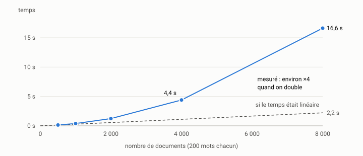

# Le banc d'essai reproductible {#sec-s08}

::: {.callout-note appearance="simple" .semaine}
## Cette semaine

Objectifs
: Savoir ce qu'on mesure quand on mesure « la vitesse » d'un programme.
  Reconnaître les sources de bruit et les maîtriser. Écrire un banc d'essai
  qui donne le même résultat demain, sur la même machine, et qui dit quelque
  chose de la complexité du code mesuré.

Lectures
: Gregg (2020), chapitre 2 (*Methodologies*), en particulier les sections sur
  la latence, le débit et les statistiques. Mytkowicz et coll. (2009),
  *Producing Wrong Data Without Doing Anything Obviously Wrong!* : l'introduction et la
  présentation des deux effets étudiés. La documentation de
  [pyperf](https://pyperf.readthedocs.io), section *Run a benchmark*.

Activité
: Critiquer le banc fourni avec `indexeur`, puis en écrire un meilleur, avec
  l'aide d'un agent.

Durée estimée
: 9 heures.
:::

## Pourquoi un bloc entier sur la mesure

Un agent de codage propose volontiers des optimisations. Il en propose même
quand on ne lui demande rien : « J'en ai profité pour rendre la boucle plus
efficace. » La phrase est plausible, et elle n'engage à rien. Plus rapide
de combien? Sur quelles entrées? Mesuré comment?

Les semaines 8 à 10 forment une seule démarche. Cette semaine, on construit
l'instrument de mesure : le banc d'essai. La semaine 9, on s'en sert pour
trouver où le temps passe (le profilage). La semaine 10, on boucle :
hypothèse, changement, mesure, décision. Sans un banc fiable, les deux
semaines suivantes ne valent rien. Une optimisation mesurée avec un
instrument bruité est une opinion.

## Ce qu'on mesure

« Ce programme est lent » peut vouloir dire plusieurs choses.

*Le temps réel* (*wall-clock time*) est le temps qui s'écoule à l'horloge
murale entre le début et la fin. C'est ce que voit l'utilisateur. En Python,
on l'obtient avec `time.perf_counter()`, une horloge monotone à haute
résolution. N'utilisez pas `time.time()` pour mesurer une durée : cette
horloge peut reculer ou sauter si le système ajuste l'heure.

*Le temps processeur* (*CPU time*) est le temps pendant lequel le
processeur a réellement exécuté votre processus. On l'obtient avec
`time.process_time()`. Il exclut le temps passé à attendre le disque, le
réseau ou un autre processus qui occupe le cœur.

*La latence* est le temps de traitement d'une requête. Le débit est
le nombre de requêtes traitées par unité de temps. Les deux ne vont pas
toujours ensemble : regrouper les requêtes par lots améliore souvent le débit
en dégradant la latence. Pour `indexeur`, l'indexation est une question de
débit (combien de documents par seconde), et la recherche, une question de
latence (combien de millisecondes pour répondre).

Précisez toujours ce que vous mesurez. « L'indexation de 2 000 documents
synthétiques de 200 mots prend 1,24 s (temps réel, médiane de 5 mesures) »
est une mesure. « L'indexation est lente » n'en est pas une.

## Le bruit

Mesurez deux fois le même code, et vous obtiendrez deux nombres différents.
Les causes sont nombreuses : d'autres processus qui partagent le processeur,
la fréquence du processeur qui varie selon la température et la charge,
l'état des antémémoires (*caches*), le ramasse-miettes, l'alimentation (un
portable sur batterie réduit souvent sa fréquence), et même la disposition
du programme en mémoire.

Voici une expérience réelle. On indexe 1 000 documents synthétiques vingt
fois de suite, d'abord sur une machine au repos, puis pendant que 28
processus Python tournent à vide sur les 14 cœurs de la même machine (un
Apple M4 Max sous macOS 15.7, avec Python 3.15.2, sur secteur) :

| Condition | Temps réel : min | médiane | max | Temps processeur : médiane |
|---|---:|---:|---:|---:|
| Machine au repos | 385,5 ms | 390,6 ms | 402,8 ms | 390,5 ms |
| Machine chargée | 936,5 ms | 1 080,5 ms | 1 202,0 ms | 468,1 ms |

Trois leçons.

1. Sur une machine chargée, le temps réel a presque triplé, alors que le
   code est identique. Une « régression » de 180 % peut venir d'une
   compilation qui tourne en arrière-plan.
2. La dispersion a explosé : l'écart entre le minimum et le maximum passe
   de 17 ms à 266 ms. Un banc d'essai doit donc rapporter la dispersion, et
   pas seulement un nombre.
3. Le temps processeur a beaucoup moins bougé (+20 %), mais il a bougé : les
   cœurs partagent des antémémoires et un budget thermique. Le temps
   processeur n'est pas un remède miracle au bruit. Il en élimine une
   partie, pas tout.

Le bruit existe aussi entre deux processus sur une machine au repos. Lancé
deux fois de suite, le même banc a donné 1 230,8 ms puis 1 277,8 ms pour
indexer 8 000 documents, un écart de 4 %. Pourtant, l'écart interquartile à
l'intérieur de chaque exécution n'était que d'environ 1 %. Comparer deux
versions à partir d'une seule exécution de chacune ne permet donc pas de
conclure à une différence de 4 %.

## Des effets qu'on ne soupçonne pas

@mytkowicz2009wrong ont montré qu'on peut obtenir des conclusions fausses
sans rien faire de manifestement incorrect. Dans leurs expériences, la
taille des variables d'environnement de l'utilisateur, ou l'ordre dans lequel
les fichiers objets sont passés à l'éditeur de liens, suffisait à faire
varier les performances. L'effet était assez fort pour qu'une optimisation du
compilateur paraisse utile ou nuisible selon la configuration. La cause est
le placement du code et de la pile en mémoire, qui change l'alignement et le
comportement des antémémoires.

Ces effets sont plus discrets en Python qu'en C, mais la leçon est générale :
*une mesure faite dans une seule configuration est une anecdote.* Elle
justifie au moins trois pratiques :

- répéter la mesure dans plusieurs processus, et pas seulement plusieurs
  fois dans le même;
- *alterner* les versions comparées (A, B, A, B…) plutôt que de tout
  mesurer de A puis tout de B : une dérive lente de la machine (température,
  tâche de fond) touche alors les deux également;
- se méfier des écarts de quelques pourcents, sauf s'ils résistent à ces
  précautions.

## Échauffement, répétitions, et quel nombre rapporter

*L'échauffement.* La première exécution est souvent plus lente : les
modules se chargent, les antémémoires se remplissent, l'allocateur réserve sa
mémoire et, dans un langage à compilateur à la volée (Java, JavaScript, PyPy,
et de plus en plus CPython), le code chaud est compilé. Un banc d'essai fait
donc une ou plusieurs exécutions non mesurées avant de mesurer. Si c'est
justement le démarrage à froid qui vous intéresse (le temps de lancement
d'une commande, par exemple), mesurez-le à part, dans des processus neufs.

*Les répétitions.* Une seule mesure ne dit rien de sa variabilité. Cinq est
un minimum, et dix à trente sont courantes pour des mesures courtes. Une
mesure doit aussi être assez longue : en dessous de la milliseconde, la
résolution de l'horloge et le coût de l'appel deviennent visibles. Pour
mesurer une opération très courte, on la répète en boucle et on divise,
comme le fait `timeit`.

*Minimum ou médiane?* Le bruit sur une machine s'ajoute presque toujours :
une interruption, un autre processus ou un défaut d'antémémoire ralentissent
le programme, et rien ne l'accélère au-delà de ce que permet le matériel. Le
*minimum* est donc l'estimation la plus proche du coût intrinsèque du
code, et il est très stable. C'est le bon choix pour les microbancs
d'essai, qui mesurent une petite fonction dans des conditions idéales. La
*médiane* décrit le cas typique et résiste aux valeurs aberrantes. C'est le
bon choix quand le bruit fait partie de ce qui vous intéresse : un programme
entier, des entrées-sorties, un service. La moyenne est sensible aux
valeurs extrêmes, et il faut toujours l'accompagner de l'écart-type.

Quel que soit le nombre choisi, rapportez aussi la dispersion : l'écart
interquartile (du premier au troisième quartile), ou le minimum et le
maximum. Si les intervalles de deux versions se chevauchent largement, vous
n'avez pas montré de différence.

## Plusieurs tailles d'entrée

Un banc qui mesure une seule taille donne un nombre. Un banc qui mesure
plusieurs tailles donne une courbe, et la courbe révèle la complexité.
Voici l'indexation d'`indexeur` 0.3.0 pour des corpus de taille croissante
(même machine, médiane de 5 mesures, 3 pour 8 000 documents, écart
interquartile entre crochets) :

| Documents | Indexation | Rapport à la ligne précédente |
|---:|---:|---:|
| 500 | 138,4 ms [137,1–141,9] | |
| 1 000 | 388,3 ms [386,0–392,3] | ×2,81 |
| 2 000 | 1 237,0 ms [1 235,2–1 245,0] | ×3,19 |
| 4 000 | 4 395,3 ms [4 382,3–4 404,2] | ×3,55 |
| 8 000 | 16 625,7 ms [16 585,3–16 675,1] | ×3,78 |

{fig-alt="Courbe des temps mesurés : 138 ms pour 500 documents, 1,24 s pour 2 000, 4,4 s pour 4 000 et 16,6 s pour 8 000. Une droite pointillée montre qu'un temps proportionnel au nombre de documents n'atteindrait que 2,2 s à 8 000 documents."}

Quand on double la taille, le temps est multiplié par un nombre qui tend vers
4 : le temps croît comme le carré du nombre de documents. Avec 8 000
documents, il faut 16,6 s. Avec 80 000, à ce rythme, il faudrait près d'une
demi-heure. Sur une seule taille, on aurait seulement conclu que « c'est un
peu lent ». Sur cinq, on sait qu'il y a un défaut d'algorithme, et non un
défaut de constante. La semaine 9 montre comment le trouver.

Le rapport tend vers 4 sans l'atteindre tout de suite, parce que le temps
total mélange une partie linéaire (découper les textes en termes) et une
partie quadratique, qui finit par dominer. C'est typique, et c'est pourquoi
il faut monter assez haut en taille.

## Les outils

`time.perf_counter()`. C'est la base. Il suffit pour un banc maison comme
celui d'`indexeur`.

`timeit`, dans la bibliothèque standard, mesure une petite instruction en
la répétant, et retient le meilleur de plusieurs séries :

```console
$ uv run python -m timeit -s "from indexeur.texte import termes; t='Le chat et le chien jouent dans le jardin de l école '*20" "termes(t)"
2000 loops, best of 5: 113 usec per loop
```

*[pyperf](https://pyperf.readthedocs.io)* fait la même chose plus
sérieusement : il lance plusieurs processus, s'échauffe, calibre le
nombre de boucles, détecte une machine instable et rapporte la moyenne avec
l'écart-type. Sous Linux, `pyperf system tune` prépare la machine (fréquence
fixe, par exemple).

```console
$ uv run python -m pyperf timeit -q -s "from indexeur.texte import termes; t='Le chat et le chien jouent dans le jardin de l école '*20" "termes(t)"
Mean +- std dev: 113 us +- 1 us
```

*[hyperfine](https://github.com/sharkdp/hyperfine)* mesure une commande
entière, quel que soit le langage, avec échauffement, répétitions et
comparaison de plusieurs commandes :

```bash
hyperfine --warmup 2 'uv run indexeur stats corpus/' 'uv run indexeur-v2 stats corpus/'
```

C'est l'outil qu'il faut pour mesurer ce que vit l'utilisateur de la ligne de
commande, démarrage de Python compris.

## Critique du banc fourni

Le dépôt contient `bancs/banc_indexation.py`. Lisez-le avant de continuer.
Il a des qualités :

- le corpus est synthétique et reproductible (graine fixe), et il suit
  approximativement une loi de Zipf, comme une vraie langue;
- le corpus est généré avant le chronométrage, de sorte qu'on ne mesure
  pas la génération;
- il fait plusieurs répétitions et rapporte la médiane, le minimum et le
  maximum;
- il utilise `time.perf_counter()`.

Il a aussi des défauts :

1. *Une seule taille par exécution.* On ne voit pas la complexité sans
   relancer le banc à la main.
2. *Pas d'échauffement.* La première répétition est comptée.
3. *Pas de description de la machine* ni de la version de Python dans la
   sortie. Dans trois semaines, vous ne saurez plus d'où viennent vos
   chiffres.
4. *Pas de sauvegarde des résultats bruts.* On ne peut pas comparer deux
   versions autrement qu'en recopiant la console.
5. *Le ramasse-miettes* peut se déclencher au milieu d'une mesure à cause
   des déchets de la précédente.
6. *Les requêtes* sont tirées des termes les plus fréquents : dans le corpus
   synthétique, les trois premiers apparaissent dans tous les documents (ou
   presque). C'est un pire cas intéressant, mais pas un cas typique. Un banc
   devrait dire ce qu'il représente.
7. *Le corpus synthétique* ne contient ni accents, ni ponctuation, ni mots
   vides. Une optimisation qui profite de cette régularité peut ne rien
   apporter, ou même nuire, sur de vrais textes.

Voici le cœur d'une version améliorée, qui corrige les défauts 1 à 5 :

```python
def mesurer(fonction, repetitions, echauffement=1):
    for _ in range(echauffement):
        fonction()
    durees = []
    for _ in range(repetitions):
        gc.collect()                      # repartir d'un tas propre
        debut = time.perf_counter()
        fonction()
        durees.append(time.perf_counter() - debut)
    return durees


def resume(durees):
    q1, _, q3 = statistics.quantiles(durees, n=4)
    return {"min": min(durees), "mediane": statistics.median(durees),
            "q1": q1, "q3": q3, "max": max(durees), "n": len(durees)}
```

La fonction principale parcourt une liste de tailles (`--tailles 500 1000
2000 4000`), affiche pour chacune la médiane, l'écart interquartile et le
rapport à la taille précédente, écrit la plateforme et la version de Python
en tête, et enregistre les résultats bruts avec `--json` :

```console
$ uv run python bancs/banc.py --tailles 500 1000 2000 4000 --repetitions 5
# macOS-15.7.7-arm64-arm-64bit-Mach-O, Python 3.15.2
documents           indexation (ms)           5 requêtes (ms)  rapport
      500       138.4 [137.1–141.9]        5.67 [5.64–5.69]
     1000       388.3 [386.0–392.3]       18.84 [18.74–19.59]  ×2.81
     2000      1237.0 [1235.2–1245.0]       71.26 [69.60–73.44]  ×3.19
     4000      4395.3 [4382.3–4404.2]      271.44 [267.51–276.70]  ×3.55
```

Remarquez la colonne des requêtes : elle aussi est multipliée par près de 4
quand la taille double. Il y a donc un second défaut quadratique, dans la
recherche cette fois.

## Faire écrire le banc par un agent

Un agent écrit un banc d'essai très vite. Il en écrit aussi de très mauvais
très vite. Les erreurs typiques :

- mesurer la génération des données en même temps que le code visé;
- mesurer un appel dont le résultat est mis en antémémoire après la première
  répétition (on mesure alors l'antémémoire, et non le code);
- rapporter la moyenne d'une seule exécution, sans dispersion;
- choisir des tailles trop petites pour que la complexité apparaisse;
- *exécuter* le banc et en résumer le résultat dans son message, au lieu de
  vous le montrer, avec des arrondis ou des confusions d'unités. Lisez la
  sortie brute.

Le cadrage de la semaine 3 s'applique : donnez à l'agent la liste des
défauts à corriger, le format de sortie voulu et la commande qui servira de
vérification. Puis relisez le code du banc ligne par ligne. C'est l'un
des rares fichiers où chaque ligne compte.

## Activité

Travaillez dans une branche `semaine-08`.

1. *Lire et critiquer.* Lisez `bancs/banc_indexation.py`. Sans regarder la
   liste ci-dessus, notez ce qui vous paraît bien et ce qui manque. Comparez
   ensuite avec la liste.

2. *Mesurer le bruit.* Lancez le banc fourni cinq fois de suite, machine au
   repos. Relancez-le pendant qu'une tâche lourde tourne (une compilation, un
   film, `uv run python -c "while True: pass"` dans deux ou trois
   terminaux). Notez dans le carnet l'écart obtenu, et la configuration :
   processeur, système, version de Python, secteur ou batterie.

3. *Rédiger une fiche de tâche* pour un banc amélioré : tailles multiples,
   échauffement, dispersion, description de la machine, résultats bruts en
   JSON, et aucune modification de `src/`. Le critère d'acceptation est
   une commande à exécuter et la forme de sa sortie.

4. *Faire exécuter la fiche* par un agent, dans une session neuve. Relisez
   le code produit ligne par ligne, en cherchant les erreurs typiques de la
   section précédente. Vérifiez que `git diff --stat` ne touche que
   `bancs/`.

5. *Établir la référence.* Lancez votre banc sur 500, 1 000, 2 000, 4 000
   et 8 000 documents, enregistrez le JSON dans `rapports/` et faites un
   commit. Ce sont les chiffres « avant » de toute la suite du bloc.

6. *Carnet.* Une entrée par session, et une entrée pour l'expérience du
   bruit.

::: {.callout-tip}
## Toujours la même machine

Toutes les mesures du bloc 3 (et du TP3) doivent être faites sur la même
machine, dans des conditions semblables : sur secteur, sans autre tâche
lourde. Un Codespace convient pour apprendre, mais ses performances varient
selon la charge de l'hôte, qui vous est invisible. Si c'est votre seule
option, multipliez les répétitions et dites-le dans le rapport.
:::

## À retenir

- On ne mesure pas « la vitesse » : on mesure un temps réel ou un temps
  processeur, une latence ou un débit, sur des entrées précises.
- Le bruit est inévitable. On le réduit (machine au repos, échauffement,
  ramasse-miettes), on le mesure (répétitions, plusieurs processus) et on le
  rapporte (dispersion).
- Le minimum convient aux microbancs, la médiane aux programmes entiers. On
  donne toujours la dispersion.
- Plusieurs tailles d'entrée révèlent la complexité. Un rapport proche de 4
  quand on double la taille signale un comportement quadratique.
- Un banc d'essai est du code : il se relit, se versionne et se critique,
  surtout s'il est écrit par un agent.

## Questions

1. Dans l'expérience du bruit, le temps processeur a augmenté de 20 % alors
   que le code n'a pas changé. Proposez deux explications matérielles.
2. Le corpus synthétique d'`indexeur` n'a pas d'accents. Quelle optimisation
   de `texte.py` pourrait paraître excellente sur ce corpus et décevante sur
   de vrais textes? Comment le banc devrait-il s'en protéger?
3. Pourquoi alterner les versions A et B pendant une comparaison, plutôt que
   de mesurer A dix fois puis B dix fois?
4. Votre agent vous annonce : « Le banc montre une amélioration de 3 %. »
   Quelles informations vous faut-il avant de le croire?

## Autoévaluation

:::: {.qcm}
::: {.question}
Pour mesurer une durée en Python, pourquoi préfère-t-on `time.perf_counter()`
à `time.time()`?

- `time.time()` mesure le temps processeur, pas le temps réel
- `perf_counter()` est une horloge monotone à haute résolution; `time.time()` peut reculer ou sauter quand le système ajuste l'heure []{.bonne}
- `perf_counter()` retire automatiquement le bruit
- `time.time()` n'existe plus en Python 3.15

::: {.explication}
Une durée se mesure avec une horloge monotone. `time.time()` donne l'heure
du système, qui peut être corrigée pendant la mesure.
:::
:::

::: {.question}
On indexe 1 000, puis 2 000, puis 4 000 documents, et le temps est
multiplié par environ 3,2 puis 3,6. Que peut-on conclure?

- Le temps croît linéairement, avec un peu de bruit
- Le temps tend vers une croissance quadratique : il y a un défaut d'algorithme, pas seulement de constante []{.bonne}
- La machine était chargée pendant les grandes tailles
- Il faut rapporter la moyenne plutôt que la médiane

::: {.explication}
Un rapport qui tend vers 4 quand la taille double signale un temps
proportionnel au carré de la taille. Le rapport n'atteint pas 4 tout de
suite, parce qu'une partie linéaire s'y mêle.
:::
:::

::: {.question}
Vous mesurez une petite fonction dans des conditions idéales (microbanc
d'essai). Quel nombre rapporter de préférence?

- La moyenne, sans autre précision
- Le maximum, pour être prudent
- Le minimum, avec une mesure de dispersion []{.bonne}
- La première mesure, avant l'échauffement

::: {.explication}
Le bruit s'ajoute presque toujours au coût intrinsèque : le minimum en est
l'estimation la plus proche et la plus stable. La médiane convient quand le
bruit fait partie de ce qu'on veut mesurer.
:::
:::

::: {.question}
Deux exécutions du même banc, sur la même machine au repos, donnent 1 231 ms
puis 1 278 ms. Que faut-il en retenir pour comparer deux versions?

- Rien : un écart de 4 % est négligeable
- Qu'il faut toujours prendre la plus petite des deux
- Qu'une seule exécution par version ne permet pas de conclure à un écart de quelques pourcents []{.bonne}
- Que la machine est défectueuse

::: {.explication}
Le bruit entre processus dépasse ici la dispersion à l'intérieur de chaque
exécution. Il faut répéter dans plusieurs processus et alterner les versions.
:::
:::

::: {.question}
Selon @mytkowicz2009wrong, qu'est-ce qui peut suffire à changer la
conclusion d'une comparaison de performance?

- La couleur du terminal
- Le nombre de tests de la suite
- La version de Git utilisée
- La taille des variables d'environnement, ou l'ordre de passage des fichiers objets à l'éditeur de liens []{.bonne}

::: {.explication}
Ces détails modifient le placement du code et de la pile en mémoire, donc le
comportement des antémémoires. Une mesure faite dans une seule configuration
est une anecdote.
:::
:::
::::
