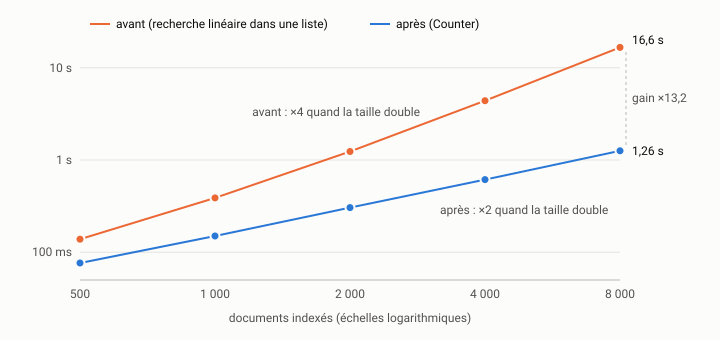

# La boucle d'optimisation {#sec-s10}

::: {.callout-note appearance="simple" .semaine}
## Cette semaine

Objectifs
: Conduire une optimisation comme une suite d'expériences : hypothèse,
  changement, mesure, décision. Protéger la correction du programme par un
  test différentiel. Tenir un journal d'optimisation qui garde aussi les
  impasses. Distinguer un gain de complexité d'un gain de constante, et
  savoir quand s'arrêter.

Lectures
: Gregg (2020), chapitre 2, sections sur la méthode scientifique et sur
  les anti-méthodes (*streetlight*, *random change*). Relire Mytkowicz et
  coll. (2009), en particulier les remèdes qu'ils proposent.

Activité
: Commencer la boucle d'optimisation du TP3 sur `indexeur`.

Durée estimée
: 10 heures, en comptant le début du TP3.
:::

## La boucle

Gregg décrit une anti-méthode qu'il appelle le changement au hasard
(*random change anti-method*) : on modifie quelque chose qui « pourrait »
aider, on lance le programme, et l'on garde le changement si l'on a
l'impression que c'est mieux [@gregg2020systems]. Avec un agent, cette
anti-méthode devient très tentante : l'agent propose cinq optimisations à la
minute, et chacune paraît raisonnable.

La boucle d'optimisation remplace l'impression par une expérience :

1. *Hypothèse.* Une phrase, fondée sur le profil : « La ligne 30 de
   `index.py` est quadratique. La remplacer par une opération en temps
   constant devrait diviser par environ 4 le temps d'indexation de 2 000
   documents, et davantage pour les tailles supérieures. »
2. *Changement.* Un seul, aussi petit que possible, dans un commit à lui.
3. *Vérification.* Les tests passent, y compris le test différentiel
   (voir plus bas).
4. *Mesure.* Le banc de la semaine 8, dans les mêmes conditions que la
   référence.
5. *Décision.* On garde le changement (commit sur la branche principale de
   l'optimisation) ou on le rejette (la branche est conservée, mais pas
   intégrée). Dans les deux cas, on écrit une ligne au journal.

Puis on reprofile, parce que le changement a déplacé le point chaud, et l'on
recommence.

*Un seul changement à la fois.* Si vous modifiez trois choses et que le
programme accélère de 30 %, vous ne savez pas laquelle des trois a aidé. Il
se peut même que l'une d'elles ralentisse le programme, masquée par les deux
autres. Les agents ont tendance à « regrouper » les améliorations. Refusez
le regroupement : une fiche, un changement, une mesure.

## Avant d'optimiser : le test différentiel

Une optimisation qui change le résultat n'est pas une optimisation. C'est un
bogue rapide. Les tests existants d'`indexeur` sont des tests d'exemples
(semaine 5) : ils vérifient quelques cas choisis à la main. Une optimisation
peut les passer tout en changeant le classement dans un cas que personne n'a
prévu, par exemple l'ordre de deux documents de même score.

Le test différentiel compare la nouvelle version à une version de
référence figée, sur beaucoup d'entrées générées. On copie le paquet
d'origine sous un autre nom (`indexeur_ref`, hors de `src/`) avant la
première optimisation, puis :

```python
@pytest.mark.parametrize("graine", range(5))
def test_memes_resultats_que_la_reference(graine):
    corpus = synthetique(300, mots_par_document=80, taille_vocabulaire=800, graine=graine)
    nouveau, ancien = Index(), ref_index.Index()
    for k, t in corpus.items():
        nouveau.ajouter(k, t)
        ancien.ajouter(k, t)
    hasard = random.Random(graine)
    vocab = sorted(ancien.postings)
    for _ in range(50):
        requete = " ".join(hasard.sample(vocab, hasard.randint(1, 3)))
        attendu = [(r.identifiant, r.score) for r in ref_recherche.rechercher(ancien, requete, k=20)]
        obtenu = [(r.identifiant, r.score) for r in rechercher(nouveau, requete, k=20)]
        assert obtenu == attendu, requete
```

Ce test exige l'égalité exacte des scores. C'est volontairement sévère :
une optimisation qui réordonne une somme de nombres à virgule flottante peut
changer le dernier chiffre d'un score, et donc l'ordre de deux documents. Si
vous décidez qu'un tel écart est acceptable, remplacez l'égalité par une
tolérance, et écrivez pourquoi dans le journal. Ce choix vous appartient.
Il ne revient pas à l'agent.

Faites ce test vous-même, ou faites-le écrire par un agent dans une session
à part, avant toute optimisation, puis interdisez sa modification pendant
la boucle (semaine 7).

## Une itération complète

Voici la première itération sur `indexeur`, faite pour préparer ce cours
(Apple M4 Max, macOS 15.7, Python 3.15.2, sur secteur, banc de la
semaine 8, médiane de 5 mesures).

*Hypothèse* (semaine 9). La ligne 30 de `Index.ajouter` parcourt une liste
pour savoir si le document y est déjà, ce qui rend l'indexation
quadratique. Prédiction : environ 310 ms pour 2 000 documents, au lieu de
1 237 ms, et un rapport proche de 2 (et non plus de 4) quand la taille
double.

*Changement.* On compte les occurrences de chaque terme du document une
fois pour toutes, puis on ajoute le document une seule fois à la liste
de chaque terme distinct :

```python
from collections import Counter

    def ajouter(self, identifiant, texte):
        ...
        for terme, n in Counter(liste).items():
            self.postings.setdefault(terme, []).append(identifiant)
            self.frequences[(terme, identifiant)] = n
```

Les listes de documents gardent l'ordre d'ajout, ce qu'exige le reste du
code. Le diff touche un seul fichier et compte 5 lignes ajoutées et 7
retirées.

*Vérification.* `uv run pytest` : 25 tests passent, dont les 5 cas du test
différentiel.

*Mesure.*

| Documents | Avant | Après | Gain |
|---:|---:|---:|---:|
| 500 | 138,4 ms | 76,4 ms | ×1,8 |
| 1 000 | 388,3 ms | 149,9 ms | ×2,6 |
| 2 000 | 1 237,0 ms | 304,4 ms | ×4,1 |
| 4 000 | 4 395,3 ms | 613,1 ms | ×7,2 |
| 8 000 | 16 625,7 ms | 1 257,2 ms | ×13,2 |

{fig-alt="Deux courbes en échelles logarithmiques. Avant : de 138,4 ms à 500 documents jusqu'à 16,6 s à 8 000 documents, le temps quadruple quand la taille double. Après : de 76,4 ms à 1,26 s, le temps double quand la taille double. Gain de 13,2 à 8 000 documents."}

La prédiction (environ 310 ms à 2 000 documents) est confirmée, à 2 % près.
Le rapport entre deux tailles successives est maintenant de 1,96 à 2,05 :
l'indexation est linéaire.

*Décision.* On garde. Commit : « Index.ajouter : Counter au lieu d'une
recherche linéaire ».

Remarquez que le temps des requêtes, que ce changement ne touche pas, est
passé de 71,3 ms à 74,3 ms. Ce n'est pas une régression, c'est le bruit
entre deux processus (semaine 8). Si vous aviez regroupé ce changement avec
une modification de la recherche, vous auriez pu attribuer cet écart au
mauvais changement.

## Complexité ou constante

Le tableau précédent montre un trait caractéristique : le gain grandit avec
la taille. C'est la signature d'un changement de complexité (ici, de
quadratique à linéaire). Un tel gain ne se résume pas en un seul nombre.
« Quatre fois plus rapide » est vrai à 2 000 documents et faux à 8 000.
Rapportez la courbe.

Un gain de constante donne au contraire à peu près le même facteur à
toutes les tailles. Il est précieux lui aussi, car un programme linéaire
deux fois plus rapide reste deux fois plus rapide. Mais il ne sauve pas un
algorithme quadratique quand les données grossissent. D'où l'ordre habituel :
*d'abord la complexité, ensuite les constantes.*

## Une impasse

Après la correction de la ligne 30 (et deux itérations sur la recherche, qui
ne touchent pas l'indexation), le reprofilage montre que `termes` représente
environ 82 % du temps d'indexation (mesure directe : 244 ms sur 297 ms). Un agent à
qui l'on montre `texte.py` propose presque toujours la même chose : « La
fonction `mots` recompile l'expression régulière à chaque appel. La compiler
une fois pour toutes, au niveau du module, accélérera la tokenisation. »

C'est une hypothèse raisonnable. On la teste, dans une branche
`impasse-regex` :

```python
MOT = re.compile(r"\w+")

def mots(texte):
    return MOT.findall(texte)
```

Les tests passent. On mesure, en alternant les deux versions et avec deux
exécutions de chacune, 11 répétitions par exécution :

| Version | Exécution | 2 000 documents | 8 000 documents |
|---|---|---:|---:|
| expression compilée | 1 | 299,9 ms | 1 288,4 ms |
| expression compilée | 2 | 302,6 ms | 1 283,6 ms |
| référence | 1 | 297,4 ms | 1 230,8 ms |
| référence | 2 | 303,0 ms | 1 277,8 ms |

Aucune différence mesurable : les écarts entre versions sont plus petits que
les écarts entre deux exécutions de la même version. L'explication est
simple : le module `re` de Python garde déjà en antémémoire les expressions
récemment compilées, de sorte que `re.findall(r"\w+", texte)` ne recompile
rien. L'agent appliquait une règle générale (« compilez vos expressions
régulières ») sans savoir si elle s'appliquait ici.

*Décision.* On rejette. La branche reste, et le journal dit pourquoi. Sans
cette ligne au journal, vous, un collègue ou un agent proposerez la même
idée le mois prochain.

Une impasse bien documentée a de la valeur. Elle dit ce qui ne marche pas et
pourquoi, et elle évite de refaire l'essai. Le TP3 exige d'ailleurs au moins
une impasse.

## Un gain qui dépend du banc

Autre proposition fréquente : mettre `normaliser` en antémémoire avec
`functools.lru_cache`, puisque les mêmes mots reviennent sans cesse. On
l'essaie (branche `essai-cache`, une ligne ajoutée) : l'indexation de 2 000
documents passe de 296 ms à 110 ms, soit un gain de 2,7. Les tests passent.

Avant de garder ce changement, demandez-vous ce que le banc représente.
Le corpus synthétique utilise un vocabulaire de 5 000 mots, sans accents ni
majuscules, tirés selon une loi de Zipf. Les 400 000 mots du corpus ne sont
donc que 5 000 mots différents, et l'antémémoire est presque toujours
touchée. Un vrai texte français a un vocabulaire bien plus riche, avec des
formes fléchies, des majuscules et des noms propres. Le gain y sera plus
faible, et l'antémémoire consommera de la mémoire. Il faut un second banc,
sur de vrais textes, pour trancher. En attendant, la décision est « en
suspens », et le journal le dit.

Méfiez-vous aussi du piège inverse : l'antémémoire persiste d'une
répétition à l'autre dans le même processus, et le banc mesure donc surtout
des exécutions où elle est déjà pleine. Ici, une mesure dans des processus
neufs (indexation unique, à froid) donne 110 à 117 ms : l'effet de
l'échauffement est faible sur ce corpus, mais il faut le vérifier, pas le
supposer.

## Le journal d'optimisation

Le journal est un tableau dans `rapports/tp3-journal.md`, une ligne par
itération, gardée ou non :

| # | Hypothèse (d'après le profil) | Changement | Commit ou branche | Avant | Après | Dispersion | Décision |
|---|---|---|---|---:|---:|---|---|
| 1 | test d'appartenance linéaire dans `ajouter` (ligne 30, ~75 % du temps) | `Counter`, un ajout par terme distinct | `da5df98` | 1 237 ms | 304 ms | IQR < 1 % | gardé; linéaire |
| 2 | recompilation de l'expression régulière dans `mots` | `re.compile` au niveau du module | `impasse-regex` | 297–303 ms | 300–303 ms | écart < bruit | rejeté : `re` met déjà en antémémoire |
| 3 | normalisation répétée des mêmes mots | `lru_cache` sur `normaliser` | `essai-cache` | 296 ms | 110 ms | IQR ~1 % | en suspens : valider sur vrais textes |

(Indexation de 2 000 documents. Le journal complet donne aussi les autres
tailles et le temps des requêtes.)

Les colonnes « avant » et « après » renvoient à des fichiers JSON de résultats
bruts versionnés, et non à des nombres recopiés à la main. Le journal est
une donnée du carnet de bord : il servira au bilan critique de la
semaine 15.

## L'agent qui annonce des gains

Un scénario typique : on demande à un agent d'« optimiser l'indexation ». Il
modifie quatre fonctions, lance le banc une fois, et conclut : « L'indexation
est maintenant environ 40 % plus rapide, et tous les tests passent. »

Que manque-t-il?

- *La référence.* Quarante pour cent par rapport à quoi? Mesurée dans le
  même processus, à la même heure? L'agent a peut-être comparé à un chiffre
  qu'il a lu dans un rapport précédent, mesuré dans d'autres conditions.
- *La dispersion.* Une seule exécution de chaque version ne permet pas de
  distinguer 40 % de 4 %, comme on l'a vu.
- *L'attribution.* Quatre changements, un seul nombre : lequel a aidé?
  L'un d'eux nuit peut-être.
- *La correction.* « Tous les tests passent », mais lesquels? Le test
  différentiel était-il là? L'agent l'a-t-il modifié?
- *Parfois, la mesure elle-même.* Certains agents « estiment » le gain à
  partir du code, sans avoir exécuté le banc. Vérifiez dans la trace de la
  session que la commande a bien été lancée, et lisez sa sortie.

La parade est la même qu'au bloc 1 : une fiche de tâche par itération, avec
l'hypothèse, le changement unique autorisé, les fichiers qu'on peut
modifier, et un critère d'acceptation qui dit comment mesurer. Par
exemple :

> Critère d'acceptation : `uv run pytest` passe sans modification de
> `tests/`. `uv run python bancs/banc.py --tailles 2000 8000 --repetitions 11
> --json rapports/mesures/iter-04.json` est exécuté deux fois, en
> alternance avec la version précédente (`git stash`). Montre-moi la sortie
> brute des quatre exécutions, sans la résumer.

L'agent peut très bien proposer les hypothèses. C'est même l'un de ses
usages les plus utiles : il connaît les idiomes rapides de Python mieux que
la plupart d'entre nous. Mais la décision repose sur la mesure, et la mesure
se lit dans la sortie brute.

## Savoir s'arrêter

Une fois la ligne 30 corrigée, `termes` représente 82 % du temps d'indexation.
D'après la loi d'Amdahl, même en rendant gratuit tout le reste de
`ajouter`, on ne gagnerait au plus que 1/0,82 ≈ 1,22, soit 22 %. Les efforts
suivants doivent donc viser `termes`, ou rien.

Plus généralement, arrêtez-vous quand l'une de ces conditions est remplie :

- *l'objectif est atteint*. Fixez-le avant de commencer, par exemple
  « indexer 100 000 documents en moins de 10 s sur ma machine ». Sans
  objectif, on ne s'arrête jamais, ou on s'arrête au hasard;
- *le point chaud restant est hors de portée* : il est dans la
  bibliothèque standard, dans le système, ou il exigerait de changer de
  langage;
- *le gain ne vaut plus le coût* : chaque optimisation rend le code un peu
  plus difficile à lire et à modifier. Un gain de 3 % qui ajoute une
  antémémoire à invalider, un cas particulier ou une dépendance (contraire à
  la règle 4 d'`ARCHITECTURE.md`) ne vaut probablement pas la peine;
- *les gains sont dans le bruit* : si deux itérations de suite ne donnent
  rien de mesurable, reprofilez avant de continuer, ou arrêtez.

## Le TP3

Le [TP3](../../evaluation.qmd#sec-tp3) vous demande d'appliquer cette
démarche à `indexeur` : un banc amélioré (semaine 8), des profils avant et
après (semaine 9), et au moins cinq itérations de la boucle, dont au
moins une proposée par l'agent et au moins une qui échoue. La page que vous
venez de lire montre deux itérations et une hésitation. Il en reste
plusieurs à trouver : la recherche, en particulier, a deux défauts révélés
par le profil de la semaine 9. Et une fois ces défauts corrigés, le profil
en révélera d'autres.

Le rapport présente les gains avec leur incertitude et sous forme de
courbe (plusieurs tailles), indique la complexité avant et après, et donne
autant de place aux impasses qu'aux succès.

## Activité

Travaillez dans une branche `tp3`, à partir de votre référence de la
semaine 8.

1. *Figer la référence.* Copiez le paquet d'origine sous le nom
   `indexeur_ref` (hors de `src/`), et écrivez le test différentiel. Vérifiez
   qu'il échoue si vous introduisez volontairement une erreur dans
   `intersection` ou dans `score_bm25` (par exemple, en changeant `B`), puis
   annulez l'erreur.

2. *Itération 1.* Reprenez votre prédiction de la semaine 9 pour la ligne 30
   d'`Index.ajouter`. Rédigez la fiche, faites faire le changement par un
   agent, vérifiez, mesurez, décidez. Votre prédiction était-elle juste?

3. *Reprofiler.* Où est maintenant le temps, pour l'indexation et pour la
   recherche?

4. *Itérations suivantes.* Demandez à un agent, dans une session neuve, de
   *proposer* trois hypothèses d'optimisation d'après le nouveau profil, sans
   rien modifier. Choisissez-en une, et menez-la jusqu'à la décision.

5. *Journal.* Tenez le journal d'optimisation dès la première itération,
   impasses comprises.

6. *Carnet.* Une entrée par session, avec le coût en jetons : les boucles
   d'optimisation consomment beaucoup de contexte (sorties de bancs, profils).
   Vous y reviendrez à la semaine 13.

## À retenir

- Optimiser, c'est expérimenter : hypothèse, changement unique, vérification,
  mesure, décision, puis reprofilage.
- Le test différentiel contre une version figée protège la correction mieux
  que des tests d'exemples. Il s'écrit avant la première optimisation.
- Un gain qui grandit avec la taille signale un changement de complexité. On
  rapporte une courbe, pas un facteur.
- Les impasses vont au journal. Elles évitent de refaire les mêmes essais et
  valent des points au TP3.
- Un gain mesuré sur un banc ne vaut que pour ce que le banc représente.
- Un agent propose de bonnes hypothèses et de mauvaises conclusions. On le
  laisse proposer, et la mesure décide.
- On fixe l'objectif avant de commencer, et l'on s'arrête quand il est atteint
  ou quand Amdahl dit que le reste ne vaut plus la peine.

## Questions

1. Le gain de l'itération 1 est ×4,1 à 2 000 documents et ×13,2 à 8 000.
   Quel gain prévoyez-vous à 32 000 documents? Comment le vérifier sans
   attendre plusieurs minutes pour la version d'origine?
2. Pourquoi le test différentiel exige-t-il l'égalité exacte des scores?
   Donnez un exemple d'optimisation correcte qui le ferait échouer, et dites
   comment vous trancheriez.
3. L'antémémoire sur `normaliser` donne ×2,7 sur le corpus synthétique.
   Concevez une expérience qui dirait si ce gain tient sur de vrais textes.
4. Un agent vous propose de réécrire `termes` en Rust, avec une extension
   Python. Que dit la règle 4 d'`ARCHITECTURE.md`? Qu'en pensez-vous, au vu de
   la loi d'Amdahl et du coût de maintenance?

## Autoévaluation

:::: {.qcm}
::: {.question}
Un agent propose trois optimisations dans un même commit, et le banc d'essai montre un gain de 30 %. Quel est le problème?

- Un gain de 30 % est trop faible pour justifier un commit
- On ne sait pas quel changement a aidé, et l'un d'eux ralentit peut-être le programme []{.bonne}
- Le banc d'essai aurait dû être lancé par l'agent plutôt que par vous
- Il fallait d'abord écrire une version en Rust pour comparer

::: {.explication}
Un seul changement à la fois. Plusieurs changements réunis se masquent les uns
les autres : un gain global peut cacher une régression.
:::
:::

::: {.question}
Avant de remplacer la recherche linéaire de `Index.ajouter`, qu'est-ce qui doit être en place?

- Un profil produit par l'agent, sans relecture
- Une estimation du gain fournie par l'agent
- Un test différentiel qui compare la nouvelle version à l'ancienne sur des entrées générées []{.bonne}
- Une nouvelle dépendance de développement pour accélérer les tests

::: {.explication}
Une optimisation ne doit pas changer le comportement. Le test différentiel
compare les sorties des deux versions et attrape une différence que les tests
d'exemples laisseraient passer.
:::
:::

::: {.question}
Après la correction, le gain d'indexation est de ×4,1 à 2 000 documents et de ×13,2 à 8 000. Comment le rapporter?

- « Le programme est quatre fois plus rapide. »
- « Le programme est treize fois plus rapide. »
- Par la moyenne des deux facteurs
- Par la courbe : un changement de complexité donne un gain qui grandit avec la taille []{.bonne}

::: {.explication}
Le passage de quadratique à linéaire ne se résume pas en un seul nombre. Un
facteur unique est vrai à une taille et faux aux autres.
:::
:::

::: {.question}
Précompiler l'expression régulière de `mots` ne change rien de mesurable. Que faites-vous de cette itération?

- On l'efface de l'historique, puisqu'elle n'a rien donné
- On la garde quand même : elle ne peut pas nuire
- On la rejette et on l'inscrit au journal comme impasse, avec ses mesures []{.bonne}
- On relance le banc jusqu'à obtenir un gain

::: {.explication}
Une impasse documentée évite de refaire l'essai, et elle montre que la
démarche est honnête. Relancer le banc jusqu'à obtenir le résultat voulu,
c'est choisir le bruit qui arrange.
:::
:::

::: {.question}
Une fois la ligne 30 corrigée, `termes` représente 82 % du temps d'indexation. Que dit la loi d'Amdahl sur le reste de `ajouter`?

- Qu'on peut encore gagner un facteur 5 en l'optimisant
- Que, même rendu gratuit, il ne ferait gagner qu'environ 22 % au plus []{.bonne}
- Qu'il faut l'optimiser avant `termes`, parce qu'il est plus simple
- Qu'elle ne s'applique pas à un programme Python

::: {.explication}
Si 82 % du temps reste dans `termes`, le gain maximal en accélérant le reste
est 1/0,82 ≈ 1,22. Les efforts suivants doivent viser `termes`, ou s'arrêter.
:::
:::
::::
