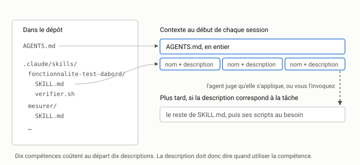

# Instructions et compétences d'équipe {#sec-s12}

::: {.callout-note appearance="simple" .semaine}
## Cette semaine

Objectifs
: Écrire un fichier d'instructions de projet court, juste et versionné.
  Savoir ce qui y va et ce qui n'y va pas. Structurer une démarche
  récurrente en compétence (*skill*) ou en commande réutilisable. Relire et
  tester des instructions comme on relit et teste du code.

Lectures
: Le site [agents.md](https://agents.md) [@agentsmd2025]. La documentation
  d'Anthropic sur les [*Agent Skills*](https://docs.anthropic.com/en/docs/agents-and-tools/agent-skills/overview)
  [@agentskills2025]. La page de votre agent sur les fichiers
  d'instructions (mémoire de projet, règles, instructions personnalisées).

Activité
: Écrire l'`AGENTS.md` d'`indexeur` et une première compétence, puis les
  éprouver en sessions neuves.

Durée estimée
: 8 heures.
:::

## Le problème : chaque session commence à zéro

Un agent n'a pas de mémoire d'une session à l'autre. Tout ce que vous lui avez
expliqué hier (« on lance les tests avec `uv run pytest`, pas `python -m
unittest` », « pas de dépendances », « la normalisation se fait dans
`texte.py` ») est oublié ce matin. Vous pouvez le répéter dans chaque demande,
comme vous l'avez fait dans les fiches de tâche du bloc 1. Ça marche, mais
c'est fastidieux, et un jour vous l'oublierez.

La solution adoptée par tous les agents est la même : un fichier
d'instructions à la racine du dépôt, que le harnais charge
automatiquement au début de chaque session. Ce fichier est du texte ordinaire,
versionné avec le code. Il est relu en revue de code comme le reste, et il
s'applique à toute l'équipe, humains et agents.

## Un fichier, plusieurs noms

Chaque outil a d'abord inventé son propre nom :

| Fichier | Lu par |
|---------|--------|
| `AGENTS.md` | Codex, Cursor, GitHub Copilot, Grok Build, OpenCode, et un nombre croissant d'autres agents |
| `CLAUDE.md` | Claude Code (qui lit `AGENTS.md` seulement en l'absence de `CLAUDE.md`) |
| `GEMINI.md` | Gemini CLI |
| `.github/copilot-instructions.md` | GitHub Copilot |
| `.cursor/rules/*.mdc` | Cursor (règles, éventuellement limitées à certains fichiers) |

`AGENTS.md` [@agentsmd2025] est une tentative de convention commune : un
fichier Markdown sans format imposé, placé à la racine (et éventuellement
dans des sous-dossiers, le plus proche du fichier modifié ayant priorité).
C'est le choix par défaut de ce cours. Si votre agent lit un autre nom, ne
dupliquez pas le contenu, car deux copies finiront par diverger. Faites
pointer l'un vers l'autre : un `CLAUDE.md` qui contient la seule ligne
`@AGENTS.md` (la syntaxe d'importation de Claude Code), ou un lien
symbolique.

La liste exacte des outils qui lisent chaque fichier change vite. Vérifiez
dans la documentation de votre agent, en date du jour.

::: {.callout-note collapse="true"}
## Dans votre agent

| Agent | Fichier d'instructions | `AGENTS.md` | Compétences et extensions |
|-------|------------------------|-------------|---------------------------|
| [Claude Code](../../agents.qmd#sec-claude-code) | `CLAUDE.md` (racine ou `.claude/`), `CLAUDE.local.md`, `~/.claude/CLAUDE.md`, `.claude/rules/` | lu seulement en l'absence de `CLAUDE.md`; sinon `@AGENTS.md` dans `CLAUDE.md` | `.claude/skills/<nom>/SKILL.md`; sous-agents dans `.claude/agents/` |
| [Codex CLI](../../agents.qmd#sec-codex) | `AGENTS.md` (ou `AGENTS.override.md`), `~/.codex/AGENTS.md`; 32 Kio au plus par défaut | natif | `.agents/skills/`; agents en TOML dans `.codex/agents/` |
| [Cursor](../../agents.qmd#sec-cursor) | `AGENTS.md`, `.cursor/rules/*.mdc`; la CLI lit aussi `CLAUDE.md` | natif | `.cursor/skills/` ou `.agents/skills/`; sous-agents dans `.cursor/agents/` |
| [GitHub Copilot](../../agents.qmd#sec-copilot) | `.github/copilot-instructions.md`, `.github/instructions/**/*.instructions.md`, `~/.copilot/copilot-instructions.md` | lu par la CLI, VS Code et l'agent infonuagique | `.github/skills/` ou `.agents/skills/`; agents `.github/agents/*.agent.md` |
| [Gemini CLI](../../agents.qmd#sec-gemini) | `GEMINI.md`, `~/.gemini/GEMINI.md` | sur configuration (`context.fileName`) ou par `@./AGENTS.md` | `.gemini/skills/` ou `.agents/skills/`; commandes `.gemini/commands/*.toml`; `.gemini/agents/` |
| [Grok Build](../../agents.qmd#sec-grok) | `AGENTS.md`, `~/.grok/AGENTS.md`, `.grok/rules/*.md` (dossier marqué fiable) | natif (lit aussi `CLAUDE.md`) | `.grok/skills/` (lit aussi `.claude/skills/` et `.agents/skills/`); `.grok/agents/` |
| [OpenCode](../../agents.qmd#sec-opencode) | `AGENTS.md`, `~/.config/opencode/AGENTS.md`; clé `instructions` d'`opencode.json` | natif (`CLAUDE.md` à défaut) | `.opencode/skills/` (lit aussi `.claude/skills/` et `.agents/skills/`); `.opencode/commands/`, `.opencode/agents/` |
| [Aider](../../agents.qmd#sec-aider) | aucun fichier chargé automatiquement; `read:` dans `.aider.conf.yml` ou `--read` | non documenté; se charge comme tout fichier avec `--read` | aucune; `--load` exécute une suite de commandes |
:::

## Ce qui va dans le fichier

Le fichier d'instructions sert à transmettre ce que l'agent ne peut pas
deviner en lisant le code, ou ce qu'il devinerait mal. Quatre catégories
couvrent l'essentiel.

*1. Les commandes.* Comment installer, tester, mesurer, formater. C'est la
partie la plus utile, et de loin. Un agent qui ne connaît pas la commande de
test en invente une, et un agent qui ne connaît pas la commande *rapide* de
test lance toute la suite à chaque modification.

*2. Les règles d'architecture.* Ce que dit `ARCHITECTURE.md`, en version
courte : le sens des dépendances, où va quoi, ce qui est interdit. Si le
document d'architecture existe, renvoyez-y plutôt que de le recopier, et
résumez seulement les règles qu'on viole le plus souvent.

*3. Les conventions.* Ce qu'un nouveau membre de l'équipe apprendrait en
une semaine de revues de code : la langue des identifiants (le français,
dans `indexeur`), le style des messages de commit, la façon de nommer les
tests.

*4. Les pièges.* Ce qui a déjà mal tourné. « Les tests de `test_cli.py`
lisent `exemples/` : ne modifiez pas ces fichiers. » « Le banc d'essai prend
une minute avec `--documents 8000` : utilisez la valeur par défaut pendant le
développement. » Chaque piège consigné dans votre carnet est candidat à une
ligne dans le fichier d'instructions.

## Ce qui n'y va pas

*Les romans.* Le fichier est chargé dans le contexte de *chaque* session et
de *chaque* requête. Mille lignes d'instructions, c'est des dizaines de
milliers de jetons payés à chaque fois, et un signal dilué : plus le fichier
est long, moins chaque instruction est suivie (semaine 13). Visez quelques
dizaines de lignes, cent tout au plus.

*Les évidences.* « Écris du code propre et bien testé. » « Sois prudent. »
Ces phrases ne changent rien au comportement du modèle, qui « croit » déjà
le faire. Une instruction utile est vérifiable : on peut dire, en
regardant un diff, si elle a été respectée. « Chaque nouvelle fonction
publique a au moins un test dans `tests/` » est vérifiable. « Teste bien »
ne l'est pas.

*Les secrets.* Le fichier est versionné, souvent public, et il est envoyé au
fournisseur du modèle à chaque requête. Aucun mot de passe, aucun jeton,
aucune adresse interne.

*Les instructions temporaires.* « Cette semaine, on travaille sur la
sortie JSON » n'a pas sa place dans un fichier qui durera des mois. Les
instructions temporaires vont dans la fiche de tâche.

*Ce que le harnais fait mieux.* « Ne pousse jamais sur GitHub » est une
instruction raisonnable, mais un modèle peut l'oublier ou être convaincu de
l'ignorer (semaine 11). Une interdiction dans les permissions ne s'oublie
pas. Les instructions guident, et les permissions contraignent.
N'utilisez pas les premières pour faire le travail des secondes.

## Un exemple complet

Voici un `AGENTS.md` raisonnable pour `indexeur`. Il tient en une page.

```markdown
# indexeur — instructions pour les agents

Moteur de recherche plein texte en Python pur. Lire ARCHITECTURE.md avant
toute modification qui touche plus d'un module.

## Commandes

- Tests, tous : `uv run pytest -q`
- Tests, un fichier : `uv run pytest -q tests/test_recherche.py`
- Banc d'essai : `uv run python bancs/banc_indexation.py` (≈ 5 s; ne pas
  augmenter --documents pendant le développement)
- Essai manuel : `uv run indexeur chercher exemples "sirop érable"`

## Règles (voir ARCHITECTURE.md)

- Dépendances : cli → recherche → index → texte. Jamais l'inverse.
- Toute normalisation de texte se fait dans `texte.termes`, nulle part
  ailleurs.
- Aucune entrée-sortie (fichiers, print) hors de `cli.py` et `corpus.py`.
- Sortie déterministe : à score égal, trier par identifiant.
- Aucune dépendance à l'exécution. Ne jamais lancer `uv add` sans accord.

## Conventions

- Identifiants, docstrings et messages en français.
- Un test au moins pour chaque fonction publique nouvelle ou modifiée, dans
  le fichier `tests/test_<module>.py` correspondant.
- Messages de commit : impératif, une ligne, moins de 72 caractères.

## Pièges

- Ne pas modifier `exemples/` : `tests/test_cli.py` en dépend.
- Ne pas modifier un test existant pour le faire passer. Si un test semble
  faux, s'arrêter et le signaler.
- `Index.postings` est une structure interne : ne pas l'utiliser dans
  `cli.py`.

## Avant de déclarer une tâche terminée

1. `uv run pytest -q` passe en entier.
2. `git diff --stat` ne touche que les fichiers prévus par la tâche.
3. Résumer : fichiers modifiés, tests ajoutés, commandes exécutées et leur
   résultat.
```

Remarquez la dernière section. Elle répond directement aux modes d'échec de
la [semaine 1](../1-formuler/s01.qmd) : elle demande une vérification
explicite et un résumé fondé sur des commandes plutôt que sur des
impressions. Elle ne garantit rien, mais elle rend l'écart visible.

## Les compétences : des démarches réutilisables

Le fichier d'instructions dit comment est le projet. Certaines
connaissances sont plutôt des démarches : « comment on ajoute une
fonctionnalité ici », « comment on mesure une optimisation », « comment on
prépare une version ». Elles sont trop longues pour le fichier
d'instructions, et elles ne servent que de temps en temps.

Les agents offrent deux mécanismes pour cela, qui se recoupent :

- *Les commandes personnalisées* : un fichier Markdown contenant une
  invite, qu'on déclenche par son nom (`/mesurer`, par exemple). Claude Code
  les lit dans `.claude/commands/`, mais sa documentation recommande
  désormais les compétences. D'autres agents ont l'équivalent sous
  d'autres noms (*prompt files* dans Copilot, par exemple). C'est vous qui
  décidez quand l'invoquer.
- *Les compétences* (*Agent Skills*) [@agentskills2025] : un dossier
  qui contient un fichier `SKILL.md` et, au besoin, des scripts et des
  documents de référence. L'en-tête de `SKILL.md` donne un nom et une
  *description*. Seuls ces deux champs sont chargés au début de la
  session. Le reste n'est lu que lorsque l'agent juge, d'après la
  description, que la compétence s'applique, ou lorsque vous l'invoquez.
  Le format, d'abord introduit par Anthropic, a été publié comme norme
  ouverte et adopté par d'autres agents.

Le chargement progressif est l'idée importante. Dix compétences ne coûtent
au départ que dix descriptions, et non dix documents complets. La
description doit donc dire quand utiliser la compétence, pas seulement
ce qu'elle fait.

{fig-alt="À gauche, le dépôt : AGENTS.md et des dossiers de compétences contenant SKILL.md et des scripts. À droite, le contexte au début de la session : AGENTS.md en entier et, pour chaque compétence, son nom et sa description. Plus tard, si la description correspond à la tâche, le reste de SKILL.md et ses scripts sont lus."}

### Exemple : ajouter une fonctionnalité, test d'abord

```
.claude/skills/fonctionnalite-test-dabord/
├── SKILL.md
└── verifier.sh
```

```markdown
---
name: fonctionnalite-test-dabord
description: Démarche pour ajouter ou modifier une fonctionnalité
  d'indexeur en écrivant les tests d'abord. À utiliser pour toute demande
  qui ajoute un comportement observable (nouvelle option, nouvelle
  commande, nouvelle fonction publique).
---

# Ajouter une fonctionnalité, test d'abord

1. Reformuler la demande en une phrase, et la liste des fichiers qui
   devraient changer. Si plus de trois fichiers de `src/` sont concernés,
   s'arrêter et proposer un découpage.
2. Écrire les tests dans `tests/test_<module>.py` : au moins un cas
   nominal, un cas limite (entrée vide, terme absent) et, si la sortie a un
   ordre, un test de déterminisme.
3. Exécuter `uv run pytest -q` et **montrer** que les nouveaux tests
   échouent, pour la bonne raison.
4. Implémenter le minimum pour les faire passer. Ne pas modifier les tests
   écrits à l'étape 2 sans le signaler explicitement.
5. Exécuter `./verifier.sh` dans le dossier de la compétence et joindre sa
   sortie au résumé final.
```

```bash
#!/bin/sh
# verifier.sh : les vérifications de fin de tâche, en une commande.
set -e
uv run pytest -q
git diff --stat
if git diff --name-only | grep -q '^exemples/'; then
  echo "ERREUR : exemples/ a été modifié." >&2
  exit 1
fi
```

L'emplacement (`.claude/skills/`) est celui de Claude Code. Pour un autre
agent, consultez sa documentation : le format `SKILL.md` est de plus en plus
répandu, mais les dossiers où l'agent le cherche diffèrent. Le script, lui,
est portable : c'est du shell ordinaire, que vous pouvez aussi exécuter à la
main.

Ce dernier point mérite qu'on s'y arrête. Une compétence qui contient un
*script* est plus fiable qu'une compétence qui ne contient que du texte.
« Vérifie que `exemples/` n'a pas changé » est une instruction que le modèle
peut mal suivre. Un `grep` dans un script ne se trompe pas. Chaque fois
qu'une étape d'une démarche est mécanique, écrivez-la en code.

## Relire et tester les instructions

Les instructions sont du code : un texte qui change le comportement d'un
programme. Elles méritent le même traitement.

*En revue de code.* Toute modification d'`AGENTS.md` ou d'une compétence
passe par une demande de fusion, comme le reste. Les questions à poser en
revue : cette ligne est-elle vérifiable? est-elle déjà dite ailleurs?
contredit-elle une autre ligne? qu'est-ce qu'elle coûte en jetons?

*Par l'expérience.* Une instruction n'est pas efficace parce qu'elle est
bien écrite. Elle l'est si l'agent change de comportement. Pour le savoir :

1. choisissez une tâche où le problème se manifeste (par exemple, l'agent
   lance `python -m pytest` au lieu de `uv run pytest`);
2. lancez-la en session neuve sans l'instruction, deux ou trois fois;
3. ajoutez l'instruction, puis relancez la même tâche en session neuve,
   autant de fois;
4. comparez.

C'est un petit essai contrôlé, et le modèle étant stochastique, une seule
exécution ne prouve rien. Trois exécutions ne prouvent pas grand-chose non
plus, mais elles suffisent souvent à repérer une instruction sans effet.

*Par l'élagage.* Une fois par mois (ou à chaque TP), relisez le fichier
et retirez ce qui n'est plus vrai ou ne sert plus. Un fichier d'instructions
périmé est pire que pas de fichier : l'agent suit avec assurance une règle
abandonnée depuis trois mois.

## Instructions personnelles et instructions d'équipe

Les agents distinguent généralement plusieurs niveaux : un fichier
personnel (dans votre dossier personnel, qui s'applique à tous vos projets),
un fichier de projet versionné (partagé par l'équipe) et parfois un fichier
local de projet non versionné. La règle est simple. Ce qui concerne le
projet va dans le fichier versionné. Ce qui concerne vos goûts (vous
préférez des explications courtes, vous travaillez en anglais) va dans le
fichier personnel. Une préférence personnelle versionnée s'impose à toute
l'équipe, et une règle de projet gardée dans un fichier personnel n'existe
pour personne d'autre.

## Activité

Sur une branche `semaine-12` de votre copie d'`indexeur`.

1. *Relire le carnet.* Parcourez votre `CARNET.md` depuis la semaine 1 et
   dressez la liste des corrections que vous avez faites plus d'une fois à la
   main. C'est la matière première de votre fichier d'instructions.
2. Écrire `AGENTS.md`. En partant de cette liste, et non de l'exemple
   ci-dessus, écrivez votre fichier : commandes, règles, conventions,
   pièges, vérification finale. Moins de 80 lignes. Si votre agent lit un
   autre nom de fichier, faites-le pointer vers `AGENTS.md`.
3. *Éprouver une instruction.* Choisissez une ligne de votre fichier qui
   corrige un comportement observé dans le carnet. Faites l'essai décrit plus
   haut : trois sessions neuves sans la ligne, trois avec. Notez les
   résultats et le coût en jetons de chaque série.
4. *Écrire une compétence.* Écrivez une compétence (ou une commande
   personnalisée, si votre agent n'a pas de compétences) pour une démarche
   que vous avez répétée au cours du bloc 2 ou du bloc 3 : « test d'abord »,
   « mesurer une optimisation » ou une autre. Incluez au moins un script de
   vérification.
5. *Éprouver la compétence.* Donnez une tâche nouvelle (une des demandes du
   `README.md`) en session neuve, sans nommer la compétence. L'agent
   l'a-t-il utilisée d'elle-même? Sinon, que faut-il changer dans la
   description?

Ces fichiers font partie des livrables du [TP4](../../evaluation.qmd#sec-tp4).

## À retenir

- Le fichier d'instructions transmet ce que l'agent ne peut pas deviner :
  commandes, règles d'architecture, conventions, pièges.
- Court et vérifiable. Pas d'évidences, pas de secrets, pas d'instructions
  temporaires.
- Les instructions guident, et les permissions contraignent. Ce qui ne doit
  jamais arriver relève des permissions.
- Une compétence est une démarche chargée à la demande, et sa description
  dit *quand* l'utiliser. Une étape mécanique s'écrit en script.
- Les instructions sont du code : on les relit en revue, on les éprouve par
  l'expérience, et on élague ce qui ne sert plus.

## Questions

1. Votre instruction éprouvée à l'étape 3 a-t-elle changé le comportement de
   l'agent? Si oui, toujours? Combien d'essais faudrait-il pour en être
   raisonnablement sûr?
2. Un collègue propose d'ajouter à `AGENTS.md` la totalité d'`ARCHITECTURE.md`,
   « pour être sûr que l'agent la lise ». Quels sont les arguments pour et
   contre? Que proposeriez-vous?
3. Un fichier d'instructions est du texte que le modèle suit. Un dépôt
   public que vous clonez peut contenir un `AGENTS.md`. Qu'est-ce que cela
   implique, compte tenu de la semaine 11?

## Autoévaluation

:::: {.qcm}
::: {.question}
Pourquoi un fichier d'instructions comme `AGENTS.md` est-il utile?

- Il donne au modèle une mémoire permanente de vos conversations passées
- Chaque session commence à zéro, et le harnais charge ce fichier au début de chacune []{.bonne}
- Il remplace les tests du projet
- Il empêche l'agent d'exécuter des commandes dangereuses

::: {.explication}
L'agent ne garde rien d'une session à l'autre. Le fichier d'instructions,
chargé automatiquement, évite de répéter les règles du projet dans chaque
demande. Il ne remplace ni les tests ni les permissions.
:::
:::

::: {.question}
Laquelle de ces lignes a le moins sa place dans `AGENTS.md`?

- « Lancer les tests avec `uv run pytest`. »
- « Aucune dépendance à l'exécution (règle 4 d'ARCHITECTURE.md). »
- « La normalisation se fait dans `texte.py`, et nulle part ailleurs. »
- « Écris du code propre et de bonne qualité. » []{.bonne}

::: {.explication}
Une évidence invérifiable coûte des jetons à chaque session sans changer le
comportement de l'agent. Les trois autres lignes sont précises et
vérifiables.
:::
:::

::: {.question}
Votre agent lit `CLAUDE.md`, et l'équipe utilise `AGENTS.md`. Que faire?

- Copier le contenu dans les deux fichiers
- Faire pointer l'un vers l'autre (importation ou lien symbolique) pour n'avoir qu'une source []{.bonne}
- Garder deux fichiers différents, un par agent
- Renoncer au fichier d'instructions

::: {.explication}
Deux copies finissent par diverger. Une seule source, et un renvoi depuis
l'autre nom.
:::
:::

::: {.question}
Vous avez dix compétences dans le dépôt. Que contient le contexte au début d'une session?

- Les dix fichiers `SKILL.md` en entier, avec leurs scripts
- Rien : les compétences ne sont lues que si vous les invoquez par leur nom
- Le nom et la description de chacune; le reste n'est lu que si une compétence s'applique []{.bonne}
- Seulement la compétence utilisée lors de la session précédente

::: {.explication}
C'est le chargement progressif. Comme seule la description est chargée au
départ, elle doit dire quand utiliser la compétence.
:::
:::

::: {.question}
Comment savoir si une nouvelle instruction est efficace?

- Si elle est bien rédigée, elle est efficace
- Demander à l'agent s'il l'a comprise
- Lancer la même tâche en sessions neuves, plusieurs fois sans l'instruction puis plusieurs fois avec, et comparer []{.bonne}
- L'ajouter en majuscules pour qu'elle soit suivie

::: {.explication}
Une instruction est efficace si le comportement change. Le modèle étant
stochastique, une seule exécution ne prouve rien : il faut un petit essai
répété, avant et après.
:::
:::
::::
