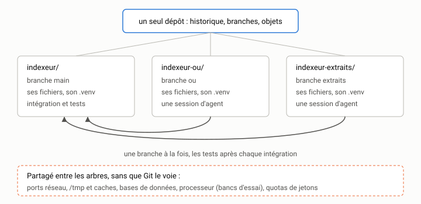

# Travailler en parallèle {#sec-s14}

::: {.callout-note appearance="simple" .semaine}
## Cette semaine

Objectifs
: Savoir quand paralléliser le travail d'agents, et quand ne pas le faire.
  Utiliser les arbres de travail Git (`git worktree`) pour isoler des sessions
  concurrentes. Reconnaître les collisions qui échappent à Git. Découper une
  évolution pour minimiser les conflits, puis intégrer proprement.

Lectures
: La page de manuel de [`git worktree`](https://git-scm.com/docs/git-worktree).
  Anthropic, [*Building Effective Agents*](https://www.anthropic.com/research/building-effective-agents)
  [@anthropic2024agents], la section sur la parallélisation. La page de votre
  agent sur les sessions parallèles ou les arbres de travail, s'il y en a
  une.

Activité
: Mener deux tâches d'`indexeur` en parallèle dans deux arbres de travail,
  puis les intégrer. Démarrer le [travail final](../../evaluation.qmd#sec-final).

Durée estimée
: 9 heures.
:::

## Pourquoi paralléliser

Un agent qui travaille sur une tâche bornée vous laisse souvent du temps
mort : il lit, exécute les tests, corrige, réexécute. Pendant ces minutes,
vous pourriez relire autre chose, ou lancer une deuxième session sur une
autre tâche. C'est l'argument du parallélisme : votre temps est la
ressource rare, pas celui de l'agent.

L'argument est réel, mais il a des limites qu'il faut voir d'avance.

*Vous restez le goulot d'étranglement.* Chaque session produit un diff que
vous devez relire. Trois sessions parallèles produisent trois diffs à relire,
et la relecture ne se parallélise pas. Si vous relisiez déjà à peine le
travail d'une session, en lancer trois ne fait qu'accumuler du code non
relu. On retrouve l'amplification de la [semaine 1](../1-formuler/s01.qmd).

*Le changement de contexte vous coûte.* Passer d'une session à l'autre,
c'est recharger dans votre tête une autre tâche, d'autres fichiers, d'autres
contraintes. Au-delà de deux ou trois sessions, la plupart des gens font
moins bien chaque tâche.

*Toutes les tâches ne se parallélisent pas.* Deux tâches qui modifient la
même fonction ne gagnent rien à être menées en même temps. Elles produiront un
conflit à l'intégration, et la seconde aurait dû partir du résultat de la
première.

La loi d'Amdahl de la [semaine 9](../3-mesurer/s09.qmd) s'applique ici
aussi : si la relecture et l'intégration représentent la moitié du temps total
d'une tâche, aucun nombre de sessions parallèles ne vous fera aller plus de
deux fois plus vite.

Le parallélisme a d'autres usages que la vitesse. On peut lancer la même
tâche dans deux sessions (deux agents, deux modèles ou deux formulations)
et garder le meilleur résultat. On peut aussi faire explorer une piste
risquée dans un coin isolé pendant qu'on avance sur la piste sûre. Dans les
deux cas, il faut que les sessions ne se gênent pas.

## Le problème : un seul répertoire de travail

Un dépôt Git ordinaire a un répertoire de travail et une branche
active. Deux sessions d'agent lancées dans le même dossier modifient les mêmes
fichiers en même temps. L'une exécute les tests pendant que l'autre est à
mi-chemin d'une modification. L'une fait `git restore .` et efface le travail
de l'autre. Le résultat est imprévisible, et il est difficile de savoir après
coup qui a fait quoi.

Cloner le dépôt deux fois résout le problème, mais crée deux dépôts distincts,
qu'il faut synchroniser par `push` et `pull`. Git offre mieux.

## Les arbres de travail Git

Un **arbre de travail** (*worktree*) est un répertoire de travail
supplémentaire, rattaché au même dépôt. Tous les arbres partagent
l'historique, les branches et les objets. Chacun a sa propre branche active
et ses propres fichiers. Un commit fait dans un arbre est immédiatement visible
dans les autres, sans `push` ni `pull`.

Partons de votre dépôt `indexeur`, sur `main`, propre. On crée deux arbres,
chacun sur une nouvelle branche, à côté du dépôt (et non dedans) :

```console
$ cd ~/cours/indexeur
$ git worktree add -b ou ../indexeur-ou main
Preparing worktree (new branch 'ou')
HEAD is now at f54a4c1 indexeur 0.3.0, version de départ
$ git worktree add -b extraits ../indexeur-extraits main
Preparing worktree (new branch 'extraits')
HEAD is now at f54a4c1 indexeur 0.3.0, version de départ
$ git worktree list
/home/vous/cours/indexeur           f54a4c1 [main]
/home/vous/cours/indexeur-extraits  f54a4c1 [extraits]
/home/vous/cours/indexeur-ou        f54a4c1 [ou]
```

L'option `-b ou` crée la branche `ou`, et le dernier argument (`main`) dit
d'où elle part. Vous avez maintenant trois dossiers. Ouvrez un terminal dans
chacun des deux nouveaux, et lancez-y une session d'agent : chaque agent ne
voit et ne modifie que son dossier.

{fig-alt="Un dépôt Git partagé et trois arbres de travail : indexeur sur main, indexeur-ou sur la branche ou, indexeur-extraits sur la branche extraits, chacun avec ses fichiers, son .venv et sa session d'agent. Les branches s'intègrent dans main, tests après chaque intégration. Ports, fichiers temporaires, bases de données, processeur et quotas restent partagés."}

Git protège contre une erreur courante : une même branche ne peut pas être
active dans deux arbres à la fois.

```console
$ git worktree add ../indexeur-bis main
fatal: 'main' is already used by worktree at '/home/vous/cours/indexeur'
```

Quand une tâche est terminée et intégrée, on retire l'arbre, puis la branche :

```console
$ git worktree remove ../indexeur-extraits
$ git branch -d extraits
```

`git worktree remove` refuse de retirer un arbre qui contient des
modifications non validées (`--force` passe outre, mais regardez d'abord
ce que vous allez perdre). Si vous avez effacé un dossier d'arbre à la main
(avec `rm -rf`), Git garde une référence orpheline. `git worktree list` la
marque `prunable`, et `git worktree prune` fait le ménage. Enfin, `git branch
-d` refuse de supprimer une branche encore active dans un arbre : retirez
l'arbre d'abord.

Quelques habitudes simples :

- *Une branche par arbre, un arbre par tâche.* Nommez l'arbre d'après la
  branche (`indexeur-ou` pour la branche `ou`).
- *Des arbres à côté du dépôt*, pas dedans. Un arbre placé dans le dépôt
  principal apparaît dans `git status`, se retrouve dans les recherches de
  l'agent et finit dans un commit par erreur. Si vous tenez à les ranger
  dans le dépôt (`.arbres/`, par exemple), ajoutez ce dossier à `.gitignore`.
- *Des arbres éphémères.* Un arbre vit le temps d'une tâche. `git worktree
  list` devrait rester court.

Certains agents créent eux-mêmes des arbres de travail pour leurs sessions
parallèles (une option `--worktree`, ou une interface qui le fait pour vous).
C'est commode. Vérifiez seulement où ils les placent et quand ils les
retirent, avec `git worktree list`.

## Les collisions que Git ne voit pas

Les arbres de travail isolent les fichiers suivis par Git. Tout le reste
est partagé : la machine, le réseau, votre dossier personnel. C'est là que se
produisent les collisions les plus déroutantes, parce que rien ne les
signale.

*L'environnement Python.* Avec uv, chaque arbre a son propre `.venv`, créé
au premier `uv run` dans le dossier de l'arbre. C'est le bon comportement :
une branche qui ajoute une dépendance de développement ne contamine pas
l'autre. Le cache de paquets d'uv, lui, est partagé, ce qui rend la création
rapide. Méfiez-vous en revanche d'un environnement activé dans votre
terminal (`source .venv/bin/activate`) : un `python` lancé depuis l'arbre `ou`
utiliserait alors l'environnement du dépôt principal. Préférez `uv run`, qui
choisit toujours l'environnement du dossier courant.

*Les ports réseau.* `indexeur` n'a pas de serveur. Dans la plupart des
projets, il y en a un : deux sessions qui lancent `npm run dev` ou un serveur
de test sur le port 8000 entrent en conflit, et la seconde échoue, ou pire,
ses tests interrogent le serveur de la première. Donnez à chaque arbre son
port, par une variable d'environnement (`PORT=8001`) inscrite dans un
fichier local non versionné.

*Les fichiers hors du dépôt.* Un test qui écrit dans `/tmp/indexeur.db`,
un cache dans `~/.cache/monprojet`, un fichier de verrou à un chemin fixe :
deux sessions qui exécutent les tests en même temps s'écrasent mutuellement.
Les résultats deviennent intermittents, ce qui rappelle les tests instables
de la [semaine 5](../2-verifier/s05.qmd). La correction est la même :
chaque test utilise son propre dossier temporaire (`tmp_path` dans pytest).

*Les bases de données et les services.* Deux branches qui appliquent des
migrations différentes à la même base de développement la laissent dans
un état qui ne correspond à aucune des deux. Une base par arbre (un fichier
SQLite dans l'arbre, ou un nom de base dérivé de la branche) évite le
problème.

*Les ressources de la machine.* Deux bancs d'essai qui tournent en même
temps se ralentissent l'un l'autre. Les mesures de la
[semaine 8](../3-mesurer/s08.qmd) prises pendant qu'une autre session
exécute ses tests ne valent rien. Les mesures se prennent seules, sur une
machine calme.

*Les quotas.* Deux sessions consomment deux fois plus de jetons, et
atteignent deux fois plus vite les limites de votre abonnement ou de votre
API.

## Découper pour ne pas entrer en conflit

Les arbres de travail empêchent les sessions de se gêner pendant le
travail. Ils ne font rien contre les conflits à l'intégration. Ceux-ci se
préviennent au moment du découpage, en appliquant ce que vous avez appris au
[bloc 1](../1-formuler/s02.qmd).

*Des fichiers disjoints.* Deux tâches qui modifient des fichiers différents
ne produisent pas de conflit textuel. Avant de lancer les sessions, écrivez
pour chaque tâche la liste des fichiers qu'elle devrait toucher, et cherchez
les recoupements. Dans `indexeur`, presque toutes les fonctionnalités
touchent `cli.py`, qui est donc le point chaud prévisible.

*Les interfaces d'abord.* Si deux tâches dépendent d'une même nouvelle
fonction (par exemple, la recherche avec OU et les extraits ont toutes deux
besoin de savoir quels termes de la requête apparaissent dans un
document), faites d'abord, seul et sur `main`, un petit commit qui définit
cette interface : la signature, la docstring, un test. Les deux sessions
parallèles partent ensuite de ce commit.

*Des fiches qui le disent.* Chaque fiche de tâche parallèle précise ce
qu'elle ne doit pas toucher : « ne pas modifier `index.py` ; si c'est
nécessaire, s'arrêter et le signaler ». C'est le « hors périmètre » de la
[semaine 3](../1-formuler/s03.qmd), qui devient ici une règle de
coordination.

*Un ordre d'intégration.* Décidez d'avance quelle branche s'intègre en
premier. En général, c'est la plus petite, ou celle dont les autres
dépendent.

## Intégrer

Quand une tâche est terminée dans son arbre (tests verts, diff relu, commit),
on l'intègre à `main`. Deux façons de faire, que vous connaissez :

```console
$ cd ~/cours/indexeur          # l'arbre principal, sur main
$ git merge --no-ff ou -m "Intègre la recherche avec OU"
$ uv run pytest -q             # toujours, après chaque intégration
```

ou, pour un historique linéaire, rebaser d'abord la branche sur `main` dans
son arbre, puis avancer `main` :

```console
$ cd ~/cours/indexeur-extraits
$ git rebase main
$ uv run pytest -q             # les tests, sur la branche rebasée
$ cd ~/cours/indexeur
$ git merge --ff-only extraits
```

La règle qui ne souffre pas d'exception : les tests après chaque
intégration, et non une seule fois à la fin. Deux branches peuvent passer
leurs tests séparément et échouer ensemble, sans aucun conflit textuel. Par
exemple, la branche `ou` change l'ordre des résultats à score égal, et un test
de la branche `extraits` dépendait de l'ancien ordre. Git ne voit rien,
pytest voit tout.

En cas de conflit textuel, vous pouvez confier la résolution à un agent, dans
l'arbre concerné, en session neuve. Donnez-lui les deux fiches de tâche, pour
qu'il sache ce que chaque côté voulait faire. Relisez le résultat avec un soin
particulier : la résolution de conflits est l'endroit où l'on perd le plus
facilement, sans s'en apercevoir, une partie du travail de l'un des deux
côtés.

## Rester synchronisé

Une branche parallèle qui vit longtemps s'éloigne de `main` à mesure que
les autres s'intègrent. Plus l'écart grandit, plus l'intégration est
difficile. Deux habitudes limitent l'écart :

- *des tâches courtes*, intégrées dans la journée plutôt que dans la
  semaine. C'est la meilleure protection, et elle découle d'un bon découpage;
- *une mise à jour régulière* des branches en cours, dès qu'une autre a
  été intégrée : `git rebase main` (ou `git merge main`) dans chaque arbre
  actif, suivi des tests.

Pensez aussi aux fichiers d'instructions. Si une branche modifie `AGENTS.md`,
les sessions des autres arbres continuent d'utiliser l'ancienne version
jusqu'à leur mise à jour. Une règle ajoutée en cours de route ne s'applique
pas rétroactivement au travail déjà fait ailleurs.

## Activité

Sur votre copie d'`indexeur`, à partir de `main` propre.

1. *Planifier.* Choisissez deux demandes du `README.md` non encore
   traitées, par exemple la recherche avec OU (demande 6) et les extraits
   autour des mots trouvés (demande 8). Pour chacune, écrivez une fiche de
   tâche avec la liste des fichiers touchés et des fichiers interdits.
   Repérez les recoupements. S'il faut une interface commune, faites-la
   d'abord sur `main`.
2. *Lancer.* Créez deux arbres de travail (`git worktree add -b …`), et
   lancez une session d'agent dans chacun, en même temps. Notez l'heure de
   début et de fin de chaque session, et le temps que vous avez passé à
   relire.
3. *Provoquer une collision hors Git.* Ajoutez dans les deux branches un
   test qui écrit un fichier à un chemin fixe (`/tmp/indexeur-test.txt`, par
   exemple), puis lancez les deux suites de tests en même temps, plusieurs
   fois. Observez-vous des échecs intermittents? Corrigez avec `tmp_path`.
4. *Intégrer.* Intégrez les deux branches dans l'ordre prévu, avec les
   tests après chaque intégration. Notez tout conflit, textuel ou non.
5. *Faire le ménage.* Retirez les arbres et les branches. `git worktree
   list` ne doit plus montrer que le dépôt principal.
6. *Carnet.* Une entrée par session, plus une entrée pour l'intégration :
   au total, le parallélisme vous a-t-il fait gagner du temps?

### Le travail final

Cette activité est une répétition du
[travail final](../../evaluation.qmd#sec-final), qui demande au moins
*trois* sous-tâches parallèles et leur intégration, suivies du bilan
critique de la [semaine 15](s15.qmd). Commencez dès cette semaine le plan de
découpage : c'est la partie la plus difficile, et celle qui décide du reste.
Gardez dans le carnet les mesures de temps de cette semaine. Elles vous
serviront de point de comparaison.

## À retenir

- Le parallélisme économise votre temps d'attente, pas votre temps de
  relecture. Vous restez le goulot d'étranglement.
- `git worktree add -b branche ../dossier main` : un arbre par tâche, une
  branche par arbre, à côté du dépôt, éphémère.
- Git isole les fichiers suivis. Les ports, les fichiers temporaires, les
  bases de données, les environnements activés et la machine elle-même
  restent partagés.
- Les conflits se préviennent au découpage : fichiers disjoints, interfaces
  d'abord, hors-périmètre explicite, ordre d'intégration décidé.
- Les tests après chaque intégration : deux branches vertes peuvent donner
  un `main` rouge.

## Questions

1. Dans votre activité, combien de temps les deux sessions parallèles
   ont-elles pris, du lancement à l'intégration? Combien auraient pris les
   deux mêmes tâches faites l'une après l'autre? Où est passé le temps?
2. Lancer la même tâche dans deux sessions et garder le meilleur résultat
   double le coût en jetons. Dans quelles situations est-ce un bon
   investissement?
3. Deux branches passent leurs tests séparément et échouent une fois
   intégrées. Quel genre de test aurait détecté le problème plus tôt, dans
   l'une des deux branches?

## Autoévaluation

:::: {.qcm}
::: {.question}
Vous passez à trois sessions d'agent en parallèle. Qu'est-ce qui limite le plus le gain de temps?

- La vitesse du modèle
- Le nombre de cœurs du processeur
- La taille de la fenêtre de contexte
- Votre relecture et l'intégration, qui ne se parallélisent pas []{.bonne}

::: {.explication}
Chaque session produit un diff à relire, et c'est vous qui relisez. Comme le dit la loi d'Amdahl, si relecture et intégration font la moitié du temps, le gain ne dépassera jamais un facteur deux.
:::
:::

::: {.question}
Que se passe-t-il si vous lancez `git worktree add ../indexeur-bis main` alors que main est déjà active dans le dépôt principal?

- Git refuse : une même branche ne peut pas être active dans deux arbres à la fois []{.bonne}
- Git crée l'arbre, et les deux dossiers se synchronisent en continu
- Git crée une copie de la branche nommée main-2
- Git crée l'arbre, mais en lecture seule

::: {.explication}
Git protège contre cette erreur. Pour travailler en parallèle, on crée une nouvelle branche par arbre, par exemple avec `git worktree add -b ou ../indexeur-ou main`.
:::
:::

::: {.question}
Deux sessions, dans deux arbres différents, exécutent les tests en même temps. Les tests échouent de façon intermittente. Quelle cause est la plus probable?

- Les deux arbres partagent le même historique Git
- Le cache de paquets d'uv est partagé
- Les tests écrivent dans un fichier à chemin fixe hors du dépôt, comme /tmp/indexeur.db []{.bonne}
- Les deux arbres ont chacun leur .venv

::: {.explication}
Git isole les fichiers suivis, pas /tmp, les caches ou les bases de données. Deux exécutions concurrentes s'écrasent mutuellement. La correction : un dossier temporaire par test (tmp_path dans pytest).
:::
:::

::: {.question}
Les branches ou et extraits passent chacune leurs tests. Pourquoi relancer les tests après chaque intégration?

- Parce que Git annule parfois une fusion sans le dire
- Parce que deux branches peuvent échouer ensemble sans le moindre conflit textuel []{.bonne}
- Parce que les tests ne s'exécutent correctement que sur main
- Parce que la fusion modifie les fichiers de tests

::: {.explication}
Par exemple, ou change l'ordre des résultats à score égal, et un test d'extraits dépendait de l'ancien ordre. Git ne voit aucun conflit; seuls les tests le révèlent.
:::
:::

::: {.question}
Deux tâches parallèles ont besoin d'une même nouvelle fonction. Quelle démarche limite les conflits?

- Laisser chaque session écrire sa propre version, puis garder la meilleure
- Confier les deux tâches à une seule session longue
- Laisser la première session finie imposer sa version à l'autre
- Faire d'abord sur main un petit commit qui définit l'interface (signature, docstring, test), puis lancer les deux sessions à partir de ce commit []{.bonne}

::: {.explication}
On définit les interfaces d'abord. Les deux sessions partent alors du même contrat, et leurs modifications portent sur des fichiers distincts.
:::
:::
::::
