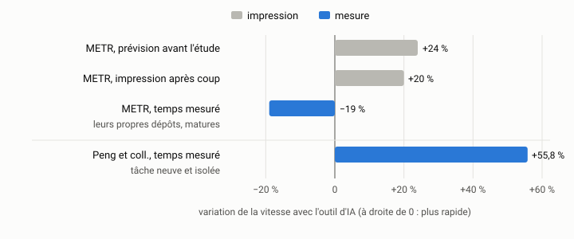

# Bilan critique {#sec-s15}

::: {.callout-note appearance="simple" .semaine}
## Cette semaine

Objectifs
: Évaluer de manière critique l'apport réel des agents de codage : les gains,
  les erreurs évitées ou amplifiées, les coûts, les risques de qualité et de
  sécurité. Appuyer ce jugement sur vos propres données et le confronter à la
  littérature.

Lectures
: Relire @becker2025metr et @peng2023copilot. Lire @perry2023insecure
  (l'introduction et les résultats) et le résumé de @jimenez2024swebench.

Activité
: Analyser votre carnet de bord, terminer et remettre le [travail
  final](../../evaluation.qmd#sec-final).

Durée estimée
: 10 heures, en plus de l'orchestration commencée à la semaine 14.
:::

## Pourquoi un bilan

Au début du cours, vous aviez une opinion sur les agents de codage : un
enthousiasme, un scepticisme, ou un peu des deux. Après quinze semaines,
vous avez autre chose : un carnet de bord rempli de dizaines de sessions,
avec la tâche, la durée, le coût et l'issue de chacune. Le bilan critique
remplace l'opinion par un jugement appuyé sur des données, en
connaissant les limites de ces données.

« Critique » ne veut pas dire « négatif ». Un bilan critique peut conclure
que les agents vous ont fait gagner beaucoup de temps. Il doit seulement
montrer d'où vient cette conclusion, et ce qui pourrait la rendre fausse.

## Ce que dit la littérature

### La productivité

Les deux études vues à la semaine 1 donnent des résultats opposés en
apparence : un gain de 55,8 % sur une tâche neuve et isolée
[@peng2023copilot], et une perte de 19 % pour des développeurs expérimentés
travaillant dans leurs propres projets matures [@becker2025metr]. Trois
observations aident à les réconcilier.

1. *La nature de la tâche compte.* Écrire un petit serveur HTTP à partir de
   rien, c'est le cas idéal : la demande est claire, le code est neuf, et
   aucune convention implicite ne s'applique. Une modification dans un grand
   projet que l'on connaît par cœur est le cas inverse : les exigences sont
   implicites, et la personne experte va déjà vite sans aide.
2. *Le temps de vérification est souvent invisible.* Dans l'étude du METR,
   une partie du temps perdu était passée à attendre l'agent, à relire son
   travail et à corriger ce qui n'allait pas. C'est exactement le coût que ce
   cours vous a appris à réduire, en bornant les tâches, en écrivant les tests
   d'abord et en gardant les sessions courtes.
3. *Notre perception est biaisée.* Les participants du METR croyaient
   avoir gagné 20 % alors qu'ils avaient perdu 19 %. Toute affirmation de
   productivité qui repose sur une impression, y compris la vôtre, est
   suspecte.

{fig-alt="Étude du METR : prévision avant l'étude +24 %, impression après coup +20 %, temps mesuré −19 %. Peng et coll., tâche neuve et isolée : +55,8 %, mesuré."}

### Les bancs d'essai publics

Les capacités des modèles se mesurent surtout par des bancs d'essai publics.
HumanEval [@chen2021codex] contient 164 problèmes de programmation courts,
chacun accompagné de tests. On y mesure le *pass@k* : la probabilité qu'au
moins une de *k* solutions générées passe les tests. SWE-bench
[@jimenez2024swebench] est beaucoup plus réaliste : 2 294 vrais tickets
(*issues*) tirés de douze dépôts Python populaires. L'agent doit produire un
correctif qui fait passer les tests ajoutés par la personne qui a réellement
résolu le ticket. À sa publication, le meilleur modèle en résolvait moins
de 2 %. Sur SWE-bench Verified, un sous-ensemble de 500 tickets validés à la
main, les meilleurs agents de 2026 en résolvent une large majorité.

Ces chiffres sont utiles, mais ils ont trois limites que vous connaissez
maintenant de l'intérieur :

- *Les tests ne disent pas tout.* Un correctif qui passe les tests du
  ticket peut tout de même être mauvais : mal placé, trop large, ou contraire
  aux conventions du projet. C'est la leçon du bloc 2.
- *La contamination.* Les dépôts de SWE-bench sont publics, et leurs
  correctifs aussi. Un modèle entraîné sur le Web peut les avoir vus.
- *Ce ne sont pas vos tâches.* Un banc d'essai mesure ce qu'il mesure. Le
  seul banc qui renseigne sur votre travail, c'est votre travail.

### La sécurité

Les études sur la sécurité du code produit avec assistance sont moins
contradictoires.

- @pearce2022asleep ont soumis à GitHub Copilot 89 scénarios propices à des
  vulnérabilités connues (injection SQL, dépassements de tampon, etc.).
  Environ 40 % des 1 689 programmes produits étaient vulnérables.
- @perry2023insecure ont mené une étude contrôlée : les participants qui
  avaient accès à un assistant ont écrit du code moins sûr que ceux du
  groupe témoin, et ils étaient plus confiants dans la sécurité de leur
  code. Cette combinaison est la plus dangereuse.
- @spracklen2025packages ont mesuré que les modèles proposent des paquets
  qui n'existent pas : au moins 5,2 % des paquets suggérés pour les
  modèles commerciaux, et 21,7 % pour les modèles ouverts. Un attaquant peut
  publier un paquet sous l'un de ces noms inventés et attendre qu'on
  l'installe.

Les agents de 2026 font mieux que les assistants de 2022, et on peut leur
demander explicitement de prêter attention à la sécurité. Le principe ne
change pas pour autant : du code que personne n'a relu avec un œil de
sécurité n'est pas sûr, qu'il vienne d'un agent ou d'un humain. Les agents
produisent plus de code, plus vite. Ils augmentent donc la quantité de code à
relire.

## Les coûts qu'on oublie

Le coût d'un agent ne se limite pas à la facture de jetons.

- *La relecture.* Chaque ligne acceptée est une ligne que vous
  maintiendrez. Le temps de relecture fait partie du coût de la tâche, et
  votre carnet doit le noter.
- *Les mauvaises pistes.* Les sessions abandonnées, et les branches
  `flou` du TP1, comptent dans le total.
- *La dette.* Un code qui fonctionne mais qui ne respecte pas
  l'architecture coûte plus tard. Le bloc 1 vous a appris à la prévenir; le
  bilan doit dire si vous y êtes parvenu.
- *La compétence.* Si l'agent écrit tout, apprenez-vous encore? Cette
  question est sérieuse, surtout en début de carrière. Une personne qui ne
  sait plus écrire un test de propriété ni lire un profil ne peut plus juger
  le travail de l'agent. Elle tombe alors dans le piège de @perry2023insecure :
  plus confiante, et moins sûre.
- *La dépendance à un fournisseur.* Les prix, les quotas et les modèles
  changent sans préavis. Un flux de travail qui ne fonctionne qu'avec un
  produit précis est fragile.

## Analyser son carnet

Commencez par compter. Le script suivant résume un carnet tenu selon le
format de la [mise en route](../../mise-en-route.qmd#sec-carnet). Adaptez-le à
vos propres champs.

```python
"""Résume CARNET.md : nombre de sessions, durée totale, résultats."""

import re
import statistics
import sys
from collections import Counter
from pathlib import Path

texte = Path(sys.argv[1] if len(sys.argv) > 1 else "CARNET.md").read_text(encoding="utf-8")
sessions = re.split(r"^## ", texte, flags=re.MULTILINE)[1:]

durees, resultats = [], Counter()
for session in sessions:
    if m := re.search(r"Durée : (\d+) min", session):
        durees.append(int(m.group(1)))
    if m := re.search(r"Résultat : (\w+)", session):
        resultats[m.group(1).lower()] += 1

print(f"sessions : {len(sessions)}")
print(f"durée totale : {sum(durees)} min (médiane {statistics.median(durees):.0f} min)")
for resultat, n in resultats.most_common():
    print(f"  {resultat:<10} {n:3d}  ({100 * n / len(sessions):.0f} %)")
```

Les chiffres ne suffisent pas, mais ils donnent un point de départ.
Viennent ensuite les questions :

1. *Où les agents ont-ils aidé?* Quels types de tâches (exploration,
   écriture de tests, nouvelle fonctionnalité, optimisation, configuration)
   ont le meilleur taux d'acceptation et le meilleur rapport temps/résultat?
2. *Où ont-ils nui?* Quelles sessions ont coûté plus de temps qu'elles
   n'en ont fait gagner? Quel était le point commun? Une demande floue, un
   contexte trop long, une tâche mal bornée?
3. *Quelles erreurs ont été évitées?* Retrouvez les régressions attrapées
   par vos tests (TP2), les « gains » démentis par vos mesures (TP3), les
   actions bloquées par votre harnais (TP4).
4. *Quelles erreurs ont été amplifiées?* Y a-t-il du code accepté que
   vous avez dû défaire plus tard? Trouvez-le dans l'historique Git
   (`git log --follow`, `git blame`).
5. *Combien cela a-t-il coûté?* En jetons, en dollars, et en heures,
   relecture comprise.
6. *Avez-vous changé?* Comparez vos premières entrées à vos dernières. Vos
   demandes se sont-elles allongées ou raccourcies? Le taux d'acceptation
   a-t-il augmenté? Pourquoi?

## Les limites de vos données

Votre carnet n'est pas une étude contrôlée, et le bilan doit le dire.

- *Pas de groupe témoin.* Vous ne savez pas combien de temps chaque tâche
  vous aurait pris sans agent. Une estimation, faite avant la session,
  vaut mieux qu'une reconstitution après coup. Le METR a montré que la
  seconde est biaisée.
- *L'effet d'apprentissage.* Vous êtes devenu meilleur pendant le cours,
  avec ou sans agent. Les dernières tâches ne sont pas comparables aux
  premières.
- *La sélection.* Les tâches du cours ont été choisies pour se prêter au
  travail avec un agent. Elles ne représentent pas tout le travail d'une
  équipe.
- *Un seul dépôt, petit.* `indexeur` compte 300 lignes. Tout ce que vous
  avez observé ne s'étend pas forcément à un dépôt de 300 000 lignes.

Nommer ces limites ne retire rien au bilan. Au contraire, cela le rend
crédible.

## Quand ne pas utiliser d'agent

Un bon bilan se termine par des recommandations concrètes. En voici
quelques-unes, à confirmer ou à contredire avec vos données.

- *Quand la tâche est plus courte que sa description.* Si écrire la fiche
  de tâche prend plus de temps que faire la modification, faites la
  modification.
- *Quand vous ne pouvez pas vérifier le résultat.* Sans test, sans mesure
  et sans compétence pour relire, vous ne déléguez pas : vous pariez.
- *Quand l'apprentissage est le but.* La première fois qu'on écrit un
  profileur, un analyseur ou un test de propriété, on l'écrit soi-même.
- *Quand le contexte ne peut pas être écrit.* Si la tâche dépend de choses
  que vous ne savez pas formuler, l'agent les devinera.
- *Quand l'erreur coûte trop cher.* Pour le code de sécurité, la
  cryptographie et les migrations de données irréversibles, un agent peut
  aider, mais la relecture doit être à la mesure du risque.

## Le travail final

Le [travail final](../../evaluation.qmd#sec-final) réunit l'orchestration de
la semaine 14 et le bilan. Pour le bilan (`rapports/bilan.md`), un plan
possible :

1. *Résumé* : votre conclusion, en cinq lignes.
2. *Données* : ce que contient le carnet, avec les chiffres et un ou deux
   tableaux.
3. *Gains* : où, combien, avec des exemples tirés de l'historique Git.
4. *Erreurs évitées et amplifiées* : des cas précis.
5. *Coûts* : jetons, argent, temps, dette.
6. *Qualité et sécurité* : ce que vous avez trouvé en relisant, et ce que
   vous avez peut-être manqué.
7. *Confrontation à la littérature* : vos résultats vont-ils dans le sens
   de @peng2023copilot, de @becker2025metr, d'aucune des deux? Pourquoi?
8. *Limites* de vos données.
9. *Recommandations* : comment vous travaillerez avec des agents demain,
   et ce que vous conseilleriez à une équipe.

## Activité

1. Exécutez le script d'analyse sur votre carnet. Complétez-le au besoin :
   coût total, taux d'acceptation par type de tâche, évolution dans le
   temps.
2. Choisissez trois sessions marquantes (un succès net, un échec net, un
   cas ambigu) et retrouvez-les dans l'historique Git. Pour chacune,
   expliquez en un paragraphe ce qui s'est passé et pourquoi.
3. Terminez l'intégration du travail parallèle commencé à la semaine 14.
4. Rédigez le bilan et remettez le travail final.

## À retenir

- Un jugement sur les agents vaut ce que valent ses données. Votre carnet
  est votre meilleure source, à condition d'en connaître les limites.
- Les études de productivité divergent parce qu'elles mesurent des tâches
  différentes. La question utile n'est pas « les agents rendent-ils plus
  productif? », mais « pour quelles tâches, à quelles conditions, à quel
  coût? ».
- Le code produit avec assistance n'est pas plus sûr par défaut, et la
  confiance qu'on lui accorde augmente plus vite que sa sûreté.
- Les habitudes de ce cours (borner, tester, mesurer, outiller, isoler) ne
  dépendent d'aucun produit. Elles resteront valables quand les outils
  d'aujourd'hui auront disparu.

## Questions

1. Si vous deviez refaire le cours avec un agent deux fois plus capable,
   lesquelles de vos conclusions changeraient? Lesquelles resteraient?
2. Quelle est, dans votre carnet, la session la plus coûteuse? Qu'auriez-vous
   dû faire autrement, et à quel moment auriez-vous pu le savoir?
3. Votre employeur vous demande s'il doit payer un abonnement à un agent pour
   toute l'équipe. Que lui répondez-vous, et sur quelles données?

## Autoévaluation

:::: {.qcm}
::: {.question}
Comment réconcilier le gain de 55,8 % mesuré par @peng2023copilot et la perte de 19 % mesurée par @becker2025metr?

- L'une des deux études est erronée
- Les études mesurent des tâches différentes : une tâche neuve et isolée d'un côté, des modifications dans de grands projets matures et bien connus de l'autre []{.bonne}
- Seule la différence de langage de programmation explique l'écart
- Les développeurs expérimentés utilisaient mal les outils

::: {.explication}
L'effet dépend de la tâche et du contexte. La bonne question n'est pas « les agents rendent-ils plus productif? », mais « pour quelles tâches, à quelles conditions, à quel coût? ».
:::
:::

::: {.question}
Un correctif fait passer les tests ajoutés pour un ticket de SWE-bench. Que peut-on en conclure?

- Que le correctif est correct et prêt à être intégré
- Que le modèle n'a jamais vu ce dépôt pendant son entraînement
- Que le correctif satisfait ces tests, ce qui ne garantit ni qu'il est bien placé ni qu'il respecte les conventions du projet []{.bonne}
- Que le modèle obtiendrait le même résultat sur vos propres tâches

::: {.explication}
Les tests ne disent pas tout (bloc 2), les dépôts publics posent un risque de contamination, et un banc d'essai public ne mesure pas votre travail.
:::
:::

::: {.question}
Quel résultat de @perry2023insecure est le plus préoccupant pour la pratique?

- Les participants avec assistant écrivaient du code moins sûr et étaient plus confiants dans sa sécurité []{.bonne}
- Les participants avec assistant étaient plus lents
- L'assistant refusait d'écrire du code de cryptographie
- Les participants sans assistant n'écrivaient aucune vulnérabilité

::: {.explication}
Moins sûr et plus confiant : cette combinaison fait baisser la garde au moment où il faudrait relire davantage.
:::
:::

::: {.question}
Votre carnet n'a pas de groupe témoin. Comment réduire ce biais pour vos prochaines sessions?

- Estimer après coup combien de temps la tâche aurait pris sans agent
- Ne noter que les sessions réussies
- Faire toutes les tâches deux fois, avec et sans agent
- Noter avant chaque session une estimation du temps que la tâche prendrait sans agent []{.bonne}

::: {.explication}
Une estimation faite avant la session vaut mieux qu'une reconstitution après coup, que l'étude du METR a montrée biaisée. Tout refaire deux fois serait plus rigoureux, mais l'effet d'apprentissage fausserait la seconde exécution.
:::
:::

::: {.question}
Dans laquelle de ces situations la page déconseille-t-elle le plus clairement de déléguer à un agent?

- Une tâche bornée avec une fiche et des tests d'acceptation
- Une tâche dont vous ne pouvez vérifier le résultat ni par des tests, ni par une mesure, ni par une relecture compétente []{.bonne}
- Une exploration du dépôt sans modification
- L'écriture d'un banc d'essai que vous savez critiquer

::: {.explication}
Sans moyen de vérifier, on ne délègue pas : on parie. Les trois autres cas sont ceux où un agent est le plus utile.
:::
:::
::::
